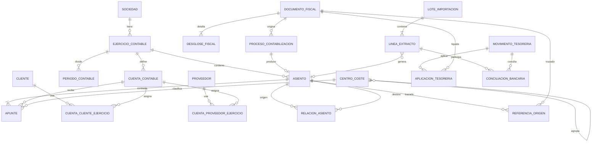

# Propuesta del nuevo núcleo contable

## Estado y alcance

Este documento inicia las fases 1 y 2 de la migración integral descrita en
`MIGRACION_PROCONTA.md`. Es una propuesta para revisión: **no autoriza ni
incluye cambios en la estructura de Access**.

El análisis se ha realizado sobre la copia local
`work/databases/ProcontaEstructura.Migracion.accdb`, el código exportado de
`work/legacy-vba` y el modelo de facturación ya existente. La base semilla no se
ha abierto ni modificado.

La propuesta persigue cinco objetivos:

1. representar explícitamente sociedades, ejercicios, asientos y apuntes;
2. impedir descuadres y referencias contables ambiguas;
3. conservar la trazabilidad desde el documento o importación de origen;
4. permitir una convivencia temporal, verificable y reversible con las tablas
   `F_*` de ContaSol.
5. servir como contrato de destino de la opción operativa `Importar ContaSol`,
   cuya transformación de datos se versionará y verificará junto con el modelo.

## Hallazgos que condicionan el diseño

### El asiento actual es implícito

`F_APU` contiene los apuntes, pero no existe una cabecera de asiento. Un asiento
se identifica en la práctica por `DIAAPU + ASIAPU` y sus líneas por `ORDAPU`.
Fecha, concepto, documento, archivo y metadatos se repiten o se reparten entre
las líneas. `F_OAS` añade notas mediante la misma clave compuesta.

Consecuencias observadas:

- no se puede garantizar por relación que todas las líneas pertenezcan al mismo
  ejercicio, diario o fecha;
- borrar, rectificar o reexportar exige localizar y coordinar varias tablas;
- `CAsiento.GrabarAsientos` comprueba el cuadre en memoria, pero el esquema no
  impide persistir conjuntos incompletos;
- las consultas de diario y mayor reconstruyen la cabecera agrupando `F_APU`.

### La numeración mezcla contador e identidad

`F_DIA.ASIDIA` funciona como siguiente número y `DIAAPU` permite separar varias
series dentro del ejercicio. No se ha identificado un caso de uso vigente que
justifique esas series, ni un requisito fiscal que obligue a reutilizar huecos o
a mantener una secuencia fiscal de números de asiento.

**Decisión confirmada:** se elimina `F_DIA` y no se migra `DIAAPU`. `IdAsiento`
será una clave técnica autonumérica `Long` de Access (entero de 32 bits),
reservada atómicamente al insertar la cabecera. No existirá un número de asiento
distinto de esa clave ni lógica para recuperar identificadores huérfanos. Los
números especiales 10000 y 20000 se sustituyen por el tipo explícito de asiento.

El perfilado de la copia respalda la simplificación: sus 2.713 apuntes forman
1.126 asientos, sólo aparece un valor de `DIAAPU`, ningún `ASIAPU` pertenece a
varios diarios y el identificador máximo actual es 1.141.

### Sociedad y ejercicio están acoplados en el legado

La tabla histórica `Sociedades` contiene simultáneamente identidad permanente,
ejercicio activo, rutas, trimestre de IVA y cuentas de configuración. El
subsistema de facturación ya creó `Sociedades` y `SociedadesEjercicios`, y
`Facturas.IdSociedadEjercicio` utiliza la segunda.

El núcleo contable debe reutilizar esas identidades, no crear una tercera noción
de empresa. Los datos permanentes pertenecen a `Sociedades`; el calendario,
estado de cierre, plan contable y configuración fiscal anual pertenecen al
ejercicio.

### Clientes y proveedores están duplicados

La misma realidad aparece en `Personas`, `Clientes`, `F_CLI`, `F_PRO` y cuentas
de `F_MAE`. En el código legado, cliente y proveedor se identifican a menudo por
su cuenta contable; el NIF no siempre es único ni está normalizado.

**Decisión confirmada:** habrá dos únicos maestros: `Clientes` y `Proveedores`.
No se introduce una tabla genérica `Terceros` ni una jerarquía de roles. Cada
maestro será común a todas las sociedades y sus cuentas contables se asignarán
por ejercicio. Un mismo sujeto que sea cliente y proveedor tendrá un registro
en cada tabla; una posible coincidencia fiscal puede documentarse sin fusionar
sus identidades funcionales.

### El IVA actual está desnormalizado

`F_IVS` y `F_IVR` almacenan hasta cuatro bases, tipos y cuotas en columnas
numeradas, junto con datos del cliente o proveedor y de la factura. El asiento referencia el
registro mediante `F_APU.CIVAPU`; `F_APU.TIVAPU` decide si ese código pertenece
al libro soportado o al repercutido. La factura de compra conserva además
`IdRegistroIVA`. Existen consultas específicas para detectar facturas sin IVA,
IVA sin factura, duplicados y descuadres del modelo 303.

El nuevo modelo necesita una cabecera fiscal y un número variable de desgloses.
Los importes fiscales deben congelarse al contabilizar; no deben recalcularse a
partir de un catálogo cuyo porcentaje pueda cambiar.

### Documento, cobro y conciliación no son lo mismo

`FacturasCompra`, `Facturas`, `Pagos`, `Recibos` y `N43Lineas` mezclan estado de
negocio con coordenadas de exportación (`ASIAPU`, `ORDAPU`, `ApunteContable`,
`LineaN43`, `Exportado`). La conciliación bancaria puede producir un asiento,
pero también puede conciliarse con un asiento existente. Un pago puede aplicarse
a una o varias facturas, y una factura puede liquidarse mediante varios pagos.

Por ello se separan:

- el movimiento de tesorería;
- su aplicación a documentos pendientes;
- la línea de extracto importada;
- la conciliación entre extracto y movimiento/apunte;
- el asiento generado por cualquiera de esos procesos.

## Casos de uso que condicionan el modelo

| Caso de uso | Exigencia estructural |
|---|---|
| Seleccionar sociedad y ejercicio | Identidad permanente de sociedad y ejercicio único por año. |
| Abrir/cerrar ejercicio | Estado explícito y fechas de bloqueo; ningún apunte nuevo dentro de un período cerrado. |
| Mantener el plan contable | Cuenta versionada por ejercicio, código único y jerarquía independiente del texto del código. |
| Crear asiento manual | Cabecera y dos o más apuntes, persistidos de forma atómica y siempre cuadrados; los céntimos de redondeo pueden ajustarse según la política de la sociedad. |
| Importar asiento | Clave idempotente de origen y lote; repetir el proceso no duplica datos. |
| Modificar o regenerar un asiento | Revisión auditada mientras no afecte a una presentación protegida ni a un cierre definitivo. |
| Rectificar un período presentado | Operación excepcional y autorizada, relacionada con la presentación que deberá rectificarse; nunca reescritura silenciosa. |
| Consultar diario, mayor y saldos | Índices por ejercicio/IdAsiento, cuenta/fecha y cuenta/estado; saldos derivados de apuntes. |
| Contabilizar factura de venta emitida | Enlace tipado a `Facturas`, instantánea fiscal y un único resultado vigente del proceso. |
| Contabilizar factura de compra | Cabecera comercial, líneas/desgloses variables, proveedor, vencimientos y asiento asociado. |
| Registrar IVA soportado/repercutido | Cabecera fiscal más desgloses; conciliación exacta con documento y asiento. |
| Contabilizar inversión del sujeto pasivo o intracomunitaria | Varios apuntes y desgloses fiscales para una operación sin forzar columnas numeradas. |
| Registrar retención, suplido o gasto por centros | Desglose fiscal separado y un centro de coste jerárquico opcional por apunte. |
| Registrar pago/cobro parcial | Relación muchos-a-muchos entre movimiento y vencimiento/documento. |
| Importar N43 | Lote y línea originales inmutables, huella anti-duplicado, cuenta bancaria identificada y `IdAsiento` opcional. |
| Conciliar extracto | Varias líneas bancarias contra varios movimientos/apuntes, con diferencias explícitas. |
| Enviar transitoriamente a 555 | Asiento normal con estado de conciliación pendiente; posterior reclasificación trazable. |
| Traspaso entre bancos | Un movimiento lógico puede vincular dos líneas de extracto sin duplicar el saldo. |
| Regularización y cierre | Tipo de asiento, relaciones de origen y numeración ordinaria; sin números mágicos. |
| Reabrir o corregir un período | Operación autorizada y auditada; nunca cambio implícito de estado. |
| Migrar ejercicios históricos | Claves de legado conservadas en un mapa, incidencias registradas y carga repetible. |

## Límites de agregados y reglas de escritura

El límite transaccional principal es `Asiento` con sus `Apuntes`. Se valida
completo antes de abrir la conexión y se inserta, numera y confirma dentro de
una única transacción Access breve. Las revisiones y vínculos de lote que
origine la operación se escriben en esa misma transacción.

`FacturaCompra`, `DocumentoFiscal`, `MovimientoTesoreria` y
`ImportacionBancaria` son agregados distintos. Su contabilización crea un
`ProcesoContabilizacion` y un `Asiento`, pero no los fusiona en la misma entidad.
Así se conservan los documentos aunque se revierta o sustituya su asiento.

## Diagrama propuesto

## Catálogo de entidades y campos

Los nombres son nombres de dominio propuestos. Los tipos concretos de Access,
longitudes y DDL se decidirán en la revisión física posterior.

### Núcleo organizativo

#### `Sociedades` (existente, reutilizada)

- `IdSociedad`: texto corto, clave primaria permanente.
- `Nombre`, `CIF`: identidad legal.
- datos permanentes de contacto y configuración compartida.

Invariantes: `IdSociedad` no cambia al abrir un ejercicio; el CIF se almacena
normalizado para búsqueda, pero se conserva el texto fiscal emitido en cada
documento.

#### `SociedadesEjercicios` (existente, ampliable después de aprobar el modelo)

- `IdSociedadEjercicio`: autonumérico, clave primaria.
- `IdSociedad`: clave externa obligatoria.
- `Ejercicio`: año de cuatro cifras.
- `FechaInicio`, `FechaFin`.
- `Estado`: `Preparacion`, `Abierto`, `CierreProvisional`, `Cerrado`.
- `FechaCierre`, `CerradoPor` opcionales.

Claves e índices: único `(IdSociedad, Ejercicio)`; índice por `Estado`.

Invariantes: las fechas no se solapan dentro de una sociedad; un ejercicio
cerrado no admite nuevas contabilizaciones ni cambios destructivos.

#### `PeriodosContables`

- `IdPeriodoContable`, `IdSociedadEjercicio`.
- `Numero`, `FechaInicio`, `FechaFin`, `Estado`, `TipoBloqueo`.

Único `(IdSociedadEjercicio, Numero)`. Permite cerrar IVA o contabilidad por
período sin usar únicamente `TrimestreActivo`.

### Plan contable, clientes y proveedores

#### `CuentasContables`

El plan es un único maestro por sociedad:

- `IdCuentaContable Long`, `IdSociedad`, `CuentaContable`, `Nombre` y
  `Descripcion`;
- `IdCentroCostePredeterminado` opcional;
- `EstaActiva` para impedir nuevos usos sin borrar la cuenta histórica.

Único `(IdSociedad, CuentaContable)`. `Nombre`, `Descripcion` y la analítica
predeterminada son datos comunes a toda la historia: corregirlos se refleja
intencionadamente también en ejercicios anteriores y no altera el valor fiscal
de los apuntes. El código de una cuenta usada no se cambia ni se reaprovecha
para otro concepto.

Todo apunte guarda directamente la clave natural `CuentaContable`. Su asiento
aporta `IdSociedadEjercicio`, y la combinación de la sociedad obtenida desde el
ejercicio y `Apuntes.CuentaContable` debe existir en `CuentasContables`. Las
entidades cuyos datos sí varían por ejercicio conservarán
`IdSociedadEjercicio`, pero el plan contable no se replica anualmente.

Convención de nombres: el prefijo `Id` se reserva para claves técnicas sin
semántica de negocio y sus referencias, como `IdAsiento` o `IdCliente`. Las
claves naturales con significado propio conservan su nombre de dominio, como
`CuentaContable`.

#### `Clientes`

- `IdCliente`: `Long`, clave primaria.
- `Nombre`, `RazonSocial`, `TipoIdentificacion`, `IdentificacionFiscal`, `Pais`.
- dirección, canales de contacto, forma de pago y estado.
- campos de auditoría.

Se reutilizará y depurará la tabla `Clientes` del subsistema de facturación. El
índice por identificación normalizada será inicialmente de búsqueda, no único,
hasta perfilar duplicados reales.

#### `Proveedores`

- `IdProveedor`: `Long`, clave primaria.
- `Nombre`, `RazonSocial`, `TipoIdentificacion`, `IdentificacionFiscal`, `Pais`.
- dirección, canales de contacto, configuración fiscal y estado.
- campos de auditoría.

Será el único maestro de proveedores y sustituirá a `F_PRO` y a las
identificaciones indirectas basadas en cuentas 400/410.

#### `CuentasClientesEjercicio` y `CuentasProveedoresEjercicio`

- clave primaria `Long` y clave externa al cliente o proveedor.
- `IdSociedadEjercicio`, `IdCuentaContable`.
- `EsPredeterminada`, `FechaDesde`, `FechaHasta`.

Cada combinación vigente de sujeto, ejercicio y cuenta es única. Estas tablas
permiten cambiar la cuenta entre ejercicios sin duplicar los maestros.

### Asientos y apuntes

#### `Asientos`

- `IdAsiento`: autonumérico `Long`, clave primaria e identificador visible.
- `IdSociedadEjercicio`: clave externa obligatoria.
- `Fecha` y `Descripcion`.
- `Tipo`: `Ordinario`, `Apertura`, `Regularizacion`, `Cierre`, `Rectificacion`.
- `TipoAsientoManual` nullable: tipo funcional heredado de
  `F_APUMANUAL.TipoApunte`; `NULL` identifica un asiento automático.
- `Notas`: información libre útil sobre el asiento, tanto manual como automático.
- `Estado`: `Borrador`, `Contabilizado`, `Anulado`.
- `OperadorCreacion`, `OperadorModificador`.
- `FechaHoraCreacion`, `FechaHoraModificacion`.
- `FechaHoraContabilizacion` opcional.
- `TotalDebe`, `TotalHaber` como instantáneas de control.
- `IdLoteProceso` opcional y `Version` obligatoria para concurrencia optimista.

Índices por `(IdSociedadEjercicio, Fecha)`, tipo y lote. No existe diario,
serie ni contador independiente: el autonumérico de Access asigna la identidad
de forma atómica y los huecos son válidos.

Invariantes:

- un asiento contabilizado tiene al menos dos apuntes y queda exactamente
  cuadrado a precisión monetaria;
- un descuadre positivo no superior a la tolerancia de la sociedad puede
  producir un único apunte técnico de redondeo en las cuentas configuradas;
- todos sus apuntes usan cuentas de su mismo ejercicio;
- `FechaContable` pertenece al ejercicio y a un período abierto;
- todo asiento manual tiene `TipoAsientoManual`; todo asiento automático tiene
  `TipoAsientoManual = NULL`; `Notas` es opcional en ambos casos;
- un asiento contabilizado puede modificarse o regenerarse con una nueva
  revisión mientras el cambio no afecte a una presentación tributaria
  protegida ni a un cierre definitivo;
- la posibilidad de modificar se evalúa por el impacto de los campos afectados,
  no sólo por la fecha o el estado del asiento;
- toda modificación, regeneración, restauración o anulación conserva operador,
  motivo y contenido anterior y posterior;
- la política de cada sociedad decide si la anulación se materializa mediante
  restauración, retirada o asiento inverso, respetando siempre los bloqueos.

#### `Apuntes`

- `IdApunte`: autonumérico `Long`.
- `IdAsiento`: clave externa `Long`.
- `Orden`, `CuentaContable`.
- `ImporteDebe` e `ImporteHaber`: `Currency` nullable, en euros.
- `Descripcion`, `NumeroFactura` y `Documento` opcionales; `Documento` contiene
  la ruta al PDF asociado.
- `IdCliente` o `IdProveedor` opcionales y mutuamente excluyentes.
- `FechaVencimiento` opcional.
- `IdCentroCoste` opcional, perteneciente a la sociedad del asiento.
- `TipoApunte`, que distingue al menos el movimiento ordinario del ajuste
  automático de redondeo.

Único `(IdAsiento, Orden)`. Índices por `(CuentaContable, IdAsiento)`, cliente,
proveedor y vencimiento.

Invariantes: exactamente uno entre `ImporteDebe` e `ImporteHaber` tiene valor,
ese valor es mayor que cero y el otro es `NULL`. El Debe y el Haber del asiento
se calculan sumando sus respectivas columnas. La fecha, descripción general y
auditoría pertenecen exclusivamente a `Asientos`. Se elimina `IMPAPU` y
cualquier otro importe en pesetas. Todos los campos tendrán nombre de dominio y
propiedad `Description` en Access.

La integridad de `CuentaContable` se valida en la misma transacción contra la
sociedad de `Asientos.IdSociedadEjercicio`; una cuenta homónima de otra sociedad
no es válida para el apunte.

El ajuste de redondeo nunca modifica bases, cuotas ni cuentas de IVA. Antes de
añadirlo se elimina o actualiza cualquier ajuste anterior generado por el mismo
proceso, evitando acumular céntimos al regenerar. La tolerancia y las cuentas de
gasto e ingreso son configuración de la sociedad; inicialmente se propone
`0,01` euro, pero no queda fijada en el dominio.

#### `RelacionesAsientos`

- `IdRelacionAsiento`, `IdAsientoOrigen`, `IdAsientoDestino`.
- `TipoRelacion`: `Inversion`, `Rectificacion`, `Reclasificacion`, `Cierre`,
  `Reapertura`.
- `Motivo`, `FechaHora`, `Operador`.

Único `(IdAsientoOrigen, IdAsientoDestino, TipoRelacion)`. No admite ciclos para
relaciones de sustitución.

#### `ReferenciasOrigenContable`

- `IdReferenciaOrigen`, `IdAsiento` y opcionalmente `IdApunte`.
- `TipoOrigen`, `IdOrigen`, `IdLoteOrigen`, `ClaveIdempotencia`.
- `EsResultadoVigente`, `FechaHoraCreacion`.

Único `(TipoOrigen, ClaveIdempotencia, EsResultadoVigente)` mediante validación
de aplicación compatible con Access. Esta tabla se reserva para importaciones,
lotes y relaciones que no dispongan de una clave externa directa. Los orígenes
operativos con cardinalidad N:1 —por ejemplo `Facturas`, `FacturasCompra`,
`Pagos` y `N43Lineas`— pueden conservar un `IdAsiento Long` nullable con relación
real a `Asientos`, facilitando consulta, deshacer y rehacer.

#### `RevisionesAsientos`

- `IdRevisionAsiento`, `IdAsiento`, `NumeroRevision` y `TipoOperacion`;
- `Motivo`, `Operador`, `FechaHora`, `IdLoteProceso` y advertencias aceptadas;
- contenido anterior y posterior de la cabecera y apuntes en una representación
  estable y versionada.

Único `(IdAsiento, NumeroRevision)`. La revisión permite reconstruir una
modificación, regeneración, restauración, anulación o retirada y se escribe con
el asiento en la misma transacción.

#### `PresentacionesTributarias`

- `IdPresentacionTributaria`, `IdSociedadEjercicio` y `TipoPresentacion`;
- `Periodicidad`, `FechaDesde`, `FechaHasta` y `EstadoPresentacion`;
- `NumeroJustificante`, `FechaHoraPresentacion`, `Operador` e
  `IdPresentacionRectificada` opcional.

El servicio de permisos contrasta los efectos de cada cambio con estas
presentaciones y con los cierres contables. Un cambio exclusivamente analítico
no se bloquea por IVA o retenciones; un cambio de fecha, tercero, base, cuota,
retención o resultado se evalúa contra las obligaciones afectadas. La política
de la sociedad puede ser estricta o flexible con confirmación y auditoría.

### Analítica

#### `CentrosCoste`

La analítica se representa mediante una jerarquía autocontenida común a todos
los ejercicios de una sociedad. Cada apunte guarda exclusivamente el nodo al
que se imputa; no duplica el nivel superior.

- `IdCentroCoste Long`, `IdSociedad` e `IdCentroCostePadre` opcional;
- `Codigo`, `Nombre`, `Descripcion`, `EsImputable`, `EstaActivo` y `Orden`;
- `Nivel`, con cero para los nodos raíz;
- `RutaJerarquica`, por ejemplo `/4/15/27/`, para buscar una rama sin SQL
  recursivo;
- `RutaOrden`, formada por segmentos de orden de longitud fija, para presentar
  el árbol mediante un `ORDER BY` ordinario;
- `IdCentroCosteRaiz`, materializado para filtrar árboles completos.

Los campos de ruta, raíz y nivel son derivados y sólo los mantiene el gestor de
centros dentro de una transacción. No se admiten ciclos, cambios de sociedad ni
la eliminación de nodos usados; se desactivan. Sólo un nodo activo e imputable
puede asignarse a apuntes nuevos. La profundidad inicial máxima será diez y la
ruta cabrá en `Text(255)`.

Los valores `F_MAE.DEPMAE` y `F_MAE.SUBMAE` se transforman en nodos raíz e
hijos y pueden actuar como imputación predeterminada de la cuenta. `F_APU`
resuelve su combinación a un único `IdCentroCoste`; un departamento sin
subdepartamento se resuelve al nodo raíz correspondiente cuando éste sea
imputable.

### Documentos fiscales

#### `DocumentosFiscales`

- `IdDocumentoFiscal`, `IdSociedadEjercicio`, `TipoDocumento` (`Venta`,
  `Compra`).
- `IdCliente` o `IdProveedor`, según el tipo; `NumeroDocumento`,
  `FechaExpedicion`, `FechaOperacion`.
- instantánea de nombre, identificación y país del cliente o proveedor.
- `TipoOperacion`, `Estado`, `Moneda`.
- `BaseTotal`, `CuotaTotal`, `RetencionTotal`, `SuplidosTotal`, `ImporteTotal`.
- `IdFacturaVenta` o `IdFacturaCompra` durante la convivencia.

La factura de venta emitida ya es el documento fiscal maestro en `Facturas`;
no debe duplicarse de inmediato. Esta entidad representa el contrato común que
podrá materializarse como vista/adaptador para ventas y tabla normalizada para
compras hasta decidir una unificación posterior.

#### `DesglosesFiscales`

El diseño fiscal detallado se encuentra en `PROPUESTA_MODELO_IVA.md`. Esa
propuesta concreta sustituye esta abstracción general por cuatro tablas
explícitas de IVA soportado/repercutido y sus desgloses.

- `IdDesgloseFiscal`, `IdDocumentoFiscal`, `NumeroLinea`.
- `Naturaleza`: `Iva`, `Recargo`, `Retencion`, `Suplido`.
- `ClaveRegimen`, `CalificacionOperacion`, `CausaExencion`.
- `TipoImpositivo`, `BaseImponible`, `Cuota`, `PorcentajeDeducible`,
  `CuotaDeducible`.
- `IdCuentaImpuesto` opcional.

Invariantes: los totales coinciden con la cabecera; exención/no sujeción y tipo
impositivo son combinaciones válidas; porcentajes e importes quedan congelados
al contabilizar.

#### `ProcesosContabilizacion`

- `IdProcesoContabilizacion`, `TipoOrigen`, `IdOrigen`.
- `ClaveIdempotencia`, `Estado`, `IdAsientoResultado`.
- `FechaHoraInicio`, `FechaHoraFin`, `DetalleIncidencia`.

Único por clave idempotente vigente. Registra intentos y permite distinguir un
fallo de validación de una contabilización confirmada.

### Tesorería y conciliación

#### `CuentasBancarias`

- `IdCuentaBancaria`, `IdSociedad`, IBAN normalizado, moneda.
- `IdCuentaContable`, nombre bancario y vigencia.

El IBAN es único por sociedad durante la vigencia. La cuenta contable pertenece
al ejercicio a través de una asignación anual cuando sea necesario.

#### `MovimientosTesoreria`

- `IdMovimientoTesoreria`, `IdSociedadEjercicio`, `Tipo` (`Cobro`, `Pago`,
  `Traspaso`, `Devolucion`).
- `IdCliente` o `IdProveedor`, `FechaOperacion`, `FechaValor`, `Importe`, `Moneda`.
- `IdCuentaBancaria` o medio de pago, `Estado`.
- referencia y clave idempotente de origen.

El signo se deriva del tipo y del sentido de la cuenta; el importe almacenado
es positivo. Un traspaso tiene dos patas explícitas o dos movimientos hermanos.

#### `AplicacionesTesoreria`

- `IdAplicacionTesoreria`, `IdMovimientoTesoreria`, `IdDocumentoFiscal` o
  `IdVencimiento`.
- `ImporteAplicado`, `FechaAplicacion`.

La suma aplicada no excede el movimiento ni el saldo pendiente del documento,
salvo una diferencia explícita autorizada.

#### `LotesImportacionBancaria` y `LineasExtractoBancario`

Conservan el fichero, formato, huella, fechas, cuenta y todos los campos
originales relevantes de N43. La línea incluye una huella única estable
calculada con cuenta, fecha, importe, referencias y ordinal del fichero.

Los datos importados son inmutables. Correcciones de clasificación y vínculos
se guardan fuera de la línea original.

#### `ConciliacionesBancarias` y `DetallesConciliacionBancaria`

- cabecera: sociedad/ejercicio, estado, fecha, operador y diferencia;
- detalles: línea de extracto, movimiento, apunte e importe conciliado.

Una conciliación confirmada cuadra sus importes. Una línea puede participar en
varios detalles parciales, pero no superar su importe. Cada línea N43 tiene como
máximo un `IdAsiento`; si un movimiento requiere varios asientos, se divide en
varias líneas enlazadas. No se introduce una relación N:M línea-asiento mientras
no aparezca un caso real que compense esa complejidad.

### Migración y auditoría

#### `LotesMigracion`, `MapasIdentidadLegado`, `IncidenciasMigracion`

Estas tablas hacen repetible la carga:

- lote con versión del extractor, origen, fechas, estado y totales;
- mapa `(SistemaOrigen, TablaOrigen, ClaveOrigen) -> (EntidadDestino, IdDestino)`;
- incidencia con severidad, datos de contexto, resolución y operador.

No se deben incrustar claves de ContaSol como claves primarias nuevas.

## Correspondencia con las tablas actuales

El tratamiento exhaustivo del resto de tablas heredadas se documenta en
`PROPUESTA_RESTO_TABLAS_CONTASOL.md`.

| Tabla/campo actual | Destino propuesto | Tratamiento |
|---|---|---|
| `Sociedades` histórica | Sin destino | No utilizar. El núcleo reutiliza exclusivamente `Sociedades` y `SociedadesEjercicios` del subsistema nuevo de facturación. |
| `F_EMP` | Sin destino | No utilizar; no es fuente del nuevo maestro de sociedades. |
| `F_DIA` | Sin destino | Suprimir. El autonumérico `Long` de `Asientos` sustituye el contador; no se migran series ni huecos. |
| `F_MAE` | `CuentasContables` | Maestro único por sociedad. Conservar código, nombre y descripción y resolver `DEPMAE` + `SUBMAE` a `IdCentroCostePredeterminado`. |
| `CuentasContables` actual | `CuentasContables` nueva | Reconciliar por sociedad y código; mantener un único maestro común a todos los ejercicios. |
| `F_CLI`, `Personas`, `Clientes` | `Clientes` + cuentas por ejercicio | Unificar en el maestro existente de facturación; deduplicación asistida y mapa de códigos originales. |
| `F_PRO` | `Proveedores` + cuentas por ejercicio | Crear un único maestro de proveedores; conservar códigos originales en el mapa. |
| `F_APU` | `Asientos` + `Apuntes` + referencias + analítica | Agrupar por `ASIAPU`; no migrar `DIAAPU`, `IMPAPU`, `GUIDAPU` ni `TRZAPU`; renombrar todos los campos conservados. |
| `F_OAS` | `Asientos.Concepto`/auditoría | Incorporar nota de cabecera; resolver discrepancias entre líneas. |
| `F_APUMANUAL` | `Asientos` | Migrar sólo el ejercicio en curso y absorber `TipoApunte`, `Notas` y auditoría; omitir cuenta origen/destino, importe, Debe/Haber y referencias libres. |
| `F_Anulacion_Asientos` | Sin destino | Suprimir sin migración. |
| `F_CLIAGRUPADOS` | Sin destino | Suprimir; la consulta de mayor ya permite seleccionar varias cuentas. |
| `F_IVS`, `F_IVR` | `DocumentosFiscales` + `DesglosesFiscales` | Despivotar grupos `BAx/PIx/CIx`; conservar importes congelados y vínculo al asiento. |
| `CuentasIVA`, `TiposDeIVA`, `CategoriasIVA` | configuración fiscal por ejercicio | Conservar catálogos útiles; separar porcentaje de la cuenta contable. |
| `Facturas` + `LineasFactura` | documento de venta existente | Mantener como maestro; añadir sólo vínculos mediante proceso/referencia tras aprobación. |
| `FacturasCompra` | documento de compra + desgloses + vencimientos | Normalizar columnas `ImporteBI0..4`, IVA, retención, transporte y suplidos. |
| `FacturasCompra1` | por determinar | Tratar como posible copia/versión; comparar contenido antes de descartar. |
| `Pagos` | `MovimientosTesoreria` + aplicaciones | Separar cobro/pago, documento aplicado y exportación contable. |
| `Recibos`, `RemesasRecibos` | vencimientos/remesas + aplicaciones | Conservar mandato, devolución y relación con extracto. |
| `DatosBancarios` | cuentas bancarias de clientes/proveedores | Normalizar IBAN; no confundir con cuentas bancarias propias. |
| `N43LotesImportacion` | `LotesImportacionBancaria` | Conservar fichero, tipo y marcas temporales; añadir huella. |
| `N43Cabeceras` | cuenta/lote de extracto | Convertir fechas e importes de texto y validar saldos de control. |
| `N43Lineas` y variantes | `LineasExtractoBancario` + conciliación | Consolidar variantes después de detectar duplicados; `ASIAPU` pasa a `IdAsiento Long`, se elimina `DIAAPU` y se usa split para más de un asiento. |
| `N43PalabrasClave` | reglas de clasificación bancaria | Conservar como configuración, nunca como prueba de conciliación. |
| `Departamentos`, `F_DEP`, `F_CDP` | `CentrosCoste` | Jerarquía permanente por sociedad con nivel, rutas materializadas y nodos imputables. |
| `F_BAN` | `Bancos` | Conservar sólo `CODBAN` → `IdBanco`, `NOMBAN` → `Nombre` y `CCOBAN` → `CuentaContable`, añadiendo la pertenencia a sociedad. |
| `DEPAPU`, `SUBAPU` | `Apuntes.IdCentroCoste` | Resolver la combinación al nodo jerárquico correspondiente. |
| `F_SAL` | Sin destino | Suprimir; era una caché calculada de ContaSol y no se usa para validar la migración. |
| tablas `MayorClientesDepor20xx` | archivo de comparación | No incorporar al núcleo; usar en pruebas de caracterización. |
| `BalancesIVAs*`, `CuadreMayor` | resultados derivados | No migrar como maestros; regenerar para comparación. |

## Datos que se conservan, transforman o descartan

### Conservar sin reinterpretar

- números y fechas contables históricos;
- códigos y nombres de cuentas usados;
- importes en euros, sentido Debe/Haber y moneda disponible;
- documentos, conceptos, notas y rutas de justificantes;
- datos fiscales congelados de facturas y libros de IVA;
- identificadores originales en `MapasIdentidadLegado`;
- contenido original de extractos y lotes bancarios;
- relaciones verificables entre factura, IVA, pago, N43 y asiento.

### Transformar con reglas explícitas

- agrupación de `F_APU` por `ASIAPU` en cabecera y líneas;
- `IMEAPU` y `D-HAPU` a `Apuntes.ImporteDebe` o `Apuntes.ImporteHaber`;
- columnas repetidas de IVA a filas de desglose;
- sociedad-ejercicio histórica a dos entidades;
- unificación separada de clientes y de proveedores;
- departamento/subdepartamento a un centro de coste jerárquico;
- fechas e importes N43 guardados como texto a tipos nativos;
- marcas `Exportado` y coordenadas físicas a procesos y referencias.

### No usar como fuente de verdad

- saldos precalculados que puedan reconstruirse;
- banderas de interfaz, selección o caché;
- contadores históricos como claves técnicas;
- importes en pesetas (`IMPAPU`) y series/diarios (`DIAAPU`, `F_DIA`);
- duplicados de respaldo (`BAK`, `AntesCambio`, tablas por año) hasta demostrar
  que contienen información exclusiva;
- números mágicos 10000/20000 para identificar regularización y cierre;
- `TRZ* = "DELETE"` y borrado físico como mecanismo de anulación.

Nada se eliminará de la base durante la convivencia. “Descartar” significa no
cargar el dato en el nuevo núcleo después de haber documentado y validado que
es derivable, técnico o duplicado.

### Campos completamente vacíos en la copia analizada

Se ha ejecutado un perfilado de sólo lectura sobre la copia local. Conforme a la
directriz acordada, estos campos se excluyen del modelo inicial porque no tienen
ningún valor no nulo/no vacío. El inventario se conserva aquí para poder
reconsiderarlos si otra base aporta datos:

| Tabla | Campos vacíos excluidos |
|---|---|
| `F_APU` | `GUIDAPU`, `TRZAPU` |
| `F_MAE` | `MEMMAE` |
| `F_CLI` | `SIGCLI`, `FAXCLI`, `MOVCLI`, `WEBCLI`, `PCOCLI`, `MEMCLI`, `BANCLI`, `ENTCLI`, `OFICLI`, `DCOCLI`, `CTACLI`, `CONCLI`, `CHACLI`, `CCOCLI`, `CC2CLI`, `CC3CLI`, `CBACLI`, `IBACLI`, `CARCLI`, `FPACLI`, `CPA1CLI` a `CPA5CLI`, `MRECLI`, `SWICLI`, `CEXCLI` |
| `F_PRO` | `NUMPRO`, `FAXPRO`, `PCOPRO`, `MEMPRO`, `BANPRO`, `CC2PRO`, `CC3PRO`, `CBAPRO`, `IBAPRO`, `CPA1PRO` a `CPA5PRO`, `SWIPRO` |
| `F_IVS` | `IIDEIVS`, `IIENIVS`, `PNUIVS`, `UNUIVS`, `DBIIVS`, `OFDIVS`, `EMIIVS`, `FDOIVS`, `FTIIVS`, `NFRIVS`, `SERIVS`, `SFRIVS`, `TRZIVS` |
| `F_IVR` | `PNUIVR`, `UNUIVR`, `DBIIVR`, `OFDIVR`, `EMIIVR`, `RCAIVR`, `FDOIVR`, `FTIIVR`, `NFRIVR`, `SERIVR`, `SFRIVR`, `TRZIVR` |

`F_DIA` no contiene campos vacíos, pero se suprime por decisión funcional, no
por falta de datos. `IMPAPU` tampoco está vacío: se descarta porque representa
pesetas y carece de significado en el nuevo sistema. Sólo uno de los 2.713
apuntes tiene `IMPAPU` no nulo y distinto de cero. En esta copia tampoco existe
ningún asiento cuyos apuntes tengan fechas distintas; la nueva cabecera evitará
estructuralmente que esa inconsistencia pueda aparecer en el futuro.

## Estrategia inicial de migración y convivencia

1. **Congelar el contrato conceptual.** Confirmar este documento, especialmente
   cierre, documentos fiscales, clientes/proveedores y tesorería.
2. **Perfilar datos.** Medir claves nulas/duplicadas, descuadres, fechas fuera de
   ejercicio y referencias huérfanas sin modificar la base.
3. **Crear pruebas de caracterización.** Diario, mayor, balance, IVA 303,
   facturas de compra y conciliación deben producir totales iguales sobre copias.
4. **Diseñar DDL y migraciones reproducibles.** Sólo tras aprobar la propuesta;
   cada tabla, relación e índice tendrá migración y copia previa.
5. **Carga en sombra.** Poblar tablas nuevas desde `F_*` en una copia, registrar
   mapas e incidencias y repetir hasta obtener resultados deterministas.
6. **Lectura comparada.** La interfaz nueva lee el modelo nuevo mientras genera
   informes comparativos contra el legado.
7. **Propiedad única por módulo.** Al activar un módulo, sólo un sistema escribe
   sus entidades. Evitar escritura dual abierta; si fuese imprescindible, usar
   una bandeja transaccional e idempotente, no llamadas encadenadas.
8. **Corte por sociedad y ejercicio.** No mezclar apuntes nuevos y antiguos en
   un mismo ejercicio sin una regla de corte explícita y conciliación de saldos.
9. **Retirada.** Mantener `F_*` en sólo lectura durante el período acordado y
   retirarlas únicamente tras cuadrar cierres e históricos.

## Pruebas de caracterización prioritarias

- todos los grupos `ASIAPU` cuadrados; detectar asientos repartidos entre varios
  `DIAAPU` antes de ignorar definitivamente el diario;
- unicidad y continuidad informativa de números, documentando huecos;
- diario y mayor por cuenta/mes iguales al legado;
- balances de situación y pérdidas y ganancias por ejercicio;
- factura de compra nacional, intracomunitaria, importación, inversión del
  sujeto pasivo, retención, suplido y transporte;
- IVA soportado/repercutido y modelo 303 por trimestre;
- factura de venta, rectificativa y periodificación;
- pago/cobro total, parcial, devolución y pago por socio/tesorería;
- importación N43 repetida sin duplicados, movimiento a 555, reclasificación y
  traspaso entre bancos;
- asiento inverso, cambio de cuenta, regularización, apertura y cierre.

## Riesgos e incidencias conocidas

| Riesgo | Respuesta propuesta |
|---|---|
| No hay clave externa fiable entre muchas tablas | Crear mapas de identidad y referencias tipadas; nunca inferir silenciosamente. |
| `F_APU` puede contener asientos parciales o descuadrados | Perfilar y enviar a incidencias; aplicar sólo el ajuste de redondeo permitido por una política explícita y registrar su resultado. |
| NIF y cuentas no identifican unívocamente a clientes o proveedores | Deduplicación separada por maestro, con puntuación y revisión humana. |
| Importes Access `Currency` y reglas VBA pueden redondear distinto | Fijar dos decimales y comparar caso a caso con el criterio ya documentado en facturación. |
| Fechas de factura se desplazan al ejercicio/trimestre activo | Separar fecha documental de fecha contable y conservar ambas. |
| Reexportar hoy puede borrar y recrear | Regenerar el asiento estable, conservar revisiones e idempotencia y bloquear sólo los cambios que afecten a presentaciones protegidas. |
| Access no ofrece todas las restricciones declarativas deseadas | Combinar índices/relaciones reales con invariantes de dominio y pruebas transaccionales. |
| Escritura concurrente del contador | Actualización condicionada por versión dentro de la misma transacción del asiento. |
| Tablas N43 duplicadas o de respaldo | Identificar procedencia y huellas antes de consolidar. |
| Facturación ya tiene un modelo operativo | Reutilizar sus IDs y adaptar ventas; no renombrar ni ampliar tablas compartidas sin coordinación. |

## Decisiones que requieren confirmación

1. **Documento fiscal común.** Confirmar si a medio plazo compras y ventas deben
   converger físicamente o sólo compartir contratos de dominio. Se recomienda
   no mover todavía `Facturas`.
2. **Conciliación.** Confirmar si se exige conciliación parcial entre extractos
   y movimientos; la relación N43-asiento queda N:1 y usa split cuando haga falta.
3. **Inicio operativo.** Elegir el primer ejercicio que será nativo y qué
   históricos quedarán sólo consultables.
4. **Cuenta 555.** Definir plazo, responsable y flujo de resolución de partidas
    pendientes; no debe ser sólo una marca técnica de exportación.

## Próximo entregable antes de tocar el esquema

Ejecutar un perfilado reproducible y de sólo lectura que cuantifique:

- claves, duplicados y huérfanos de las tablas de correspondencia;
- asientos descuadrados o con cabecera ambigua;
- divergencias entre facturas, libros de IVA y apuntes;
- cobertura real de pagos/recibos/N43;
- calidad de la unificación separada de clientes y proveedores;
- volumen por sociedad, ejercicio y caso fiscal.

Con esas cifras se cerrarán las decisiones anteriores y se preparará el diseño
físico de tablas, campos Access, relaciones, índices y orden de migraciones.
