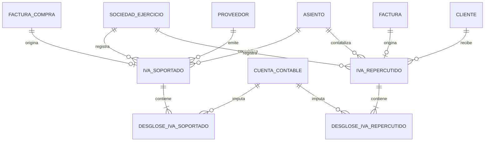

# Propuesta de modelo para IVA soportado y repercutido

## Estado y decisión principal

Este documento detalla el diseño fiscal anticipado en
`PROPUESTA_MODELO_CONTABLE.md`. Es una propuesta para revisión y no contiene
cambios de esquema.

Se proponen dos libros independientes y normalizados, cada uno con cabecera y
desgloses:

- `IVASoportado` y `DesglosesIVASoportado`;
- `IVARepercutido` y `DesglosesIVARepercutido`.

No se propone una tabla polimórfica única. Aunque ambos libros comparten muchos
campos, sus sujetos y reglas no son iguales: el soportado pertenece a un
proveedor y contiene deducibilidad; el repercutido pertenece normalmente a un
cliente y puede incluir recargo de equivalencia. Mantener tablas distintas hace
que las claves externas y los campos obligatorios sean comprensibles también en
Access.

Tampoco se copiarán columnas por tipo impositivo. Cada combinación fiscal será
una fila de desglose, sin límites como `PI1`, `PI2`, `PI3`.

Los nombres de tablas se expresan en plural y los nombres de entidades/clases en
singular. Por tanto, el catálogo será `TiposOperacion` y su entidad de dominio
`TipoOperacion`, de acuerdo con las convenciones generales del proyecto.

## Catálogos y valores cerrados

### `TiposOperacion`

Será un catálogo mantenido con las claves vigentes de los libros electrónicos y
las clasificaciones necesarias para obtener el modelo 303. No se reutilizarán
los números `TIPIVS`/`TIPIVR`, porque su significado es incompleto y distinto
entre compras y ventas.

Campos propuestos:

| Campo | Finalidad |
|---|---|
| `IdTipoOperacion` | Clave técnica `Long`. |
| `Codigo` | Código interno estable e inteligible. |
| `Nombre` | Denominación funcional. |
| `Libro` | `Soportado`, `Repercutido` o `Ambos`. |
| `CodigoAeat` | Clave vigente del formato electrónico aplicable. |
| `ClaveRegimenAeat` | Régimen especial o trascendencia cuando proceda. |
| `CalificacionAeat` | Sujeta, exenta o no sujeta cuando proceda. |
| `RequiereTipoBienServicio` | Indica si debe informarse Bien/Servicio. |
| `PermiteInversionSujetoPasivo` | Valida esa combinación. |
| `FechaDesde`, `FechaHasta` | Vigencia del código sin reescribir históricos. |
| `EstaActivo` | Evita seleccionar códigos retirados. |

`Codigo` será único y `CodigoAeat + Libro + FechaDesde` no se repetirá. La
traducción a casillas del 303 se mantendrá versionada junto con el catálogo, no
mediante condicionales dispersos en formularios. La carga inicial se basará en
los diseños de libros publicados por la AEAT y vigentes desde el 1 de enero de
2026; deberá revisarse al cambiar esos diseños.

Cuando un tipo afecte a varias casillas, la correspondencia se expresará en una
tabla hija `MapeosTiposOperacionModelo303` con versión del modelo, clase de
importe (`Base`, `CuotaDevengada` o `CuotaDeducible`) y número de casilla. No se
añadirán columnas `Casilla1`, `Casilla2`, etc. a `TiposOperacion`.

### `TipoBienServicio`

Es un valor cerrado de dominio, no una tabla: sólo admite `Bien` y `Servicio`.
En persistencia puede representarse como texto inteligible validado. Será nulo
cuando el tipo de operación no exija distinguirlos y obligatorio cuando
`TiposOperacion.RequiereTipoBienServicio` sea verdadero.

## Evidencia del modelo actual

La copia analizada contiene:

| Libro | Registros | Uso observado |
|---|---:|---|
| `F_IVS` | 159 | 137 operaciones nacionales, 21 intracomunitarias y 1 importación según `TIPIVS`. |
| `F_IVR` | 162 | Todas aparecen con `TIPIVR = 0`; 18 contienen retención de alquiler. |

En `F_IVS`, 158 registros usan el primer tramo de IVA y sólo uno usa además el
segundo. En `F_IVR`, 138 registros tienen base exenta y 24 usan un tramo con
cuota. Esto confirma que el número de tramos es variable y que las columnas
repetidas no aportan una estructura estable.

Además:

- `LIBIVS` y `LIBIVR` siempre valen 1;
- `PDEIVS` aparece en los 159 registros;
- `DEDIVS`, `INVIVS`, `IMPIVS`, `TOIIVS`, `PLAIVS`, `RCCIVS` y `LOCIVS`
  siempre valen cero;
- `CVIIVS` y `CVIIVR` siempre valen 1;
- numerosos campos nunca contienen datos y ya figuran en el inventario de
  exclusión del modelo contable.

Esos valores constantes no se trasladarán como columnas por inercia. Si una
regla fiscal futura los necesita, se incorporará con nombre y significado
explícitos.

## Diagrama

La relación factura–registro fiscal es 1:0..1. No toda factura en borrador tiene
registro de IVA; una factura contabilizada que afecte al libro sí debe tenerlo.
Un asiento puede contabilizar varios registros en un proceso agrupado; de ahí la
cardinalidad N:1 hacia `Asientos`.

## `IVASoportado`

### Finalidad

Representa una factura recibida tal como debe incorporarse al libro registro de
facturas recibidas. Es una instantánea fiscal: no es un catálogo de tipos ni un
resumen reconstruido desde el asiento.

### Campos propuestos

| Campo | Tipo Access orientativo | Nulo | Descripción |
|---|---|---:|---|
| `IdIVASoportado` | `AUTOINCREMENT`/`Long` | No | Clave técnica del registro fiscal. |
| `IdSociedadEjercicio` | `Long` | No | Sociedad y ejercicio que presentan el impuesto. |
| `IdFacturaCompra` | `Long` | No | Factura de compra que origina el registro. |
| `IdProveedor` | `Long` | No | Proveedor emisor. |
| `IdAsiento` | `Long` | Sí | Asiento que contabiliza el registro; nulo antes de contabilizar. |
| `FechaExpedicion` | `DateTime` | No | Fecha que consta en la factura del proveedor. |
| `FechaOperacion` | `DateTime` | No | Fecha de realización de la operación. |
| `FechaHoraRegistroContable` | `DateTime` | No | Momento real en que se ejecutó la contabilización; dato de auditoría. |
| `IdPeriodoIVA` | `Long` | No | Período de liquidación en el que se incorpora la operación. |
| `NumeroFactura` | `Text` | No | Número original del proveedor, conservando formato. |
| `NombreProveedor` | `Text` | No | Instantánea del nombre o razón social. |
| `IdentificacionFiscalProveedor` | `Text` | Sí | Instantánea del NIF u otra identificación fiscal. |
| `PaisProveedor` | `Text(2)` | No | Código ISO del país utilizado para clasificar la operación. |
| `IdTipoOperacion` | `Long` | No | Clasificación vigente tomada de `TiposOperacion`. |
| `TipoBienServicio` | `Text` | Sí | `Bien` o `Servicio` cuando la operación lo requiera. |
| `InversionSujetoPasivo` | `YesNo` | No | Indica autorrepercusión del impuesto. |
| `ImporteTotalFactura` | `Currency` | No | Total documental, no suma fiscal implícita. |
| `BaseImponibleTotal` | `Currency` | No | Suma congelada de bases de los desgloses. |
| `CuotaSoportadaTotal` | `Currency` | No | Suma de cuotas soportadas. |
| `CuotaDevengadaAutorrepercutidaTotal` | `Currency` | No | Suma de cuotas devengadas por ISP o adquisición intracomunitaria. |
| `CuotaDeducibleTotal` | `Currency` | No | Suma de cuotas fiscalmente deducibles. |
| `IncluidoModelo347` | `YesNo` | No | Materialización del cálculo para operaciones con terceros. |
| `Estado` | `Text` | No | Borrador, Contabilizado o Anulado. |
| `IdIVASoportadoRectificado` | `Long` | Sí | Registro anterior al que rectifica. |
| `Descripcion` | `LongText` | Sí | Observaciones fiscales, no notas técnicas. |
| `OperadorCreacion` | `Text` | No | Usuario que creó la instantánea. |
| `OperadorModificador` | `Text` | Sí | Último usuario antes de contabilizar. |
| `FechaHoraCreacion` | `DateTime` | No | Momento de creación. |
| `FechaHoraModificacion` | `DateTime` | Sí | Última modificación permitida. |

`NumeroFactura`, nombre, identificación y país se duplican deliberadamente
respecto de factura/proveedor: son la instantánea declarada y no deben variar si
después se corrige el maestro.

### Claves e índices

- primaria: `IdIVASoportado`;
- única: `IdFacturaCompra`;
- índice de libro: `(IdSociedadEjercicio, IdPeriodoIVA)`;
- búsqueda de duplicados: `(IdSociedadEjercicio, IdProveedor, NumeroFactura,
  FechaExpedicion)`;
- índices simples en `IdAsiento` e `IdIVASoportadoRectificado`.

El índice de duplicados no debe ser único: un mismo número puede repetirse por
serie, proveedor o rectificación. El dominio mostrará una advertencia con los
registros coincidentes.

## `DesglosesIVASoportado`

| Campo | Tipo Access orientativo | Nulo | Descripción |
|---|---|---:|---|
| `IdDesgloseIVASoportado` | `AUTOINCREMENT`/`Long` | No | Clave técnica. |
| `IdIVASoportado` | `Long` | No | Cabecera del libro recibido. |
| `Orden` | `Integer` | No | Orden estable dentro del registro. |
| `ClaveRegimen` | `Text` | No | Clave fiscal aplicable. |
| `CalificacionOperacion` | `Text` | No | Sujeta/no exenta, exenta o no sujeta. |
| `CausaExencion` | `Text` | Sí | Causa cuando la operación esté exenta. |
| `BaseImponible` | `Currency` | No | Base del tramo. |
| `TipoIVA` | `Decimal` | No | Porcentaje; se almacena 21, no 0,21. |
| `CuotaSoportada` | `Currency` | No | Cuota que figura o se autorrepercute. |
| `CuotaDevengadaAutorrepercutida` | `Currency` | No | Cuota devengada por adquisición intracomunitaria o ISP; cero en operaciones ordinarias. |
| `PorcentajeDeducible` | `Decimal` | No | Porcentaje deducible entre 0 y 100. |
| `CuotaDeducible` | `Currency` | No | Cuota deducible congelada. |
| `IdCuentaIVASoportado` | `Long` | Sí | Cuenta 472 utilizada al contabilizar. |
| `IdCuentaIVARepercutido` | `Long` | Sí | Cuenta 477 de la autorrepercusión; nula si no procede. |

Único `(IdIVASoportado, Orden)`. También se impedirá duplicar dentro de una
cabecera la misma combinación fiscal salvo que una diferencia de cuenta o
deducibilidad lo justifique.

La deducibilidad pertenece al desglose, no a la cabecera: una factura puede
contener cuotas con porcentajes distintos. La prorrata aplicada queda congelada;
una regularización posterior crea el movimiento fiscal correspondiente y no
reescribe el porcentaje histórico.

## `IVARepercutido`

### Finalidad y orígenes

Representa el libro de facturas expedidas y el IVA devengado por ventas. Su
origen es una factura real de `Facturas`. Una compra intracomunitaria o con
inversión del sujeto pasivo no crea una factura expedida ficticia: su cuota
devengada se conserva en `DesglosesIVASoportado.CuotaDevengadaAutorrepercutida`
y genera los apuntes 472/477 desde ese mismo registro recibido.

### Campos propuestos

| Campo | Tipo Access orientativo | Nulo | Descripción |
|---|---|---:|---|
| `IdIVARepercutido` | `AUTOINCREMENT`/`Long` | No | Clave técnica del registro fiscal. |
| `IdSociedadEjercicio` | `Long` | No | Sociedad y ejercicio declarante. |
| `IdFactura` | `Long` | No | Factura de venta origen. |
| `IdCliente` | `Long` | No | Destinatario de la factura. |
| `IdAsiento` | `Long` | Sí | Asiento que contabiliza el registro. |
| `FechaExpedicion` | `DateTime` | No | Fecha de expedición de la factura. |
| `FechaOperacion` | `DateTime` | No | Fecha de devengo/operación. |
| `FechaHoraRegistroContable` | `DateTime` | No | Momento efectivo de contabilización; dato de auditoría. |
| `IdPeriodoIVA` | `Long` | No | Período de liquidación al que se asigna el registro. |
| `NumeroFactura` | `Text` | No | Número fiscal o referencia de autorrepercusión. |
| `NombreCliente` | `Text` | Sí | Instantánea del destinatario. |
| `IdentificacionFiscalCliente` | `Text` | Sí | Instantánea de identificación. |
| `PaisCliente` | `Text(2)` | Sí | País utilizado en la clasificación fiscal. |
| `IdTipoOperacion` | `Long` | No | Clasificación tomada de `TiposOperacion`. |
| `TipoBienServicio` | `Text` | Sí | `Bien` o `Servicio` cuando la operación lo requiera. |
| `ImporteTotalFactura` | `Currency` | No | Total documental o de la operación origen. |
| `BaseImponibleTotal` | `Currency` | No | Suma de bases. |
| `CuotaRepercutidaTotal` | `Currency` | No | Suma de IVA devengado. |
| `RecargoEquivalenciaTotal` | `Currency` | No | Suma de recargos. |
| `IncluidoModelo347` | `YesNo` | No | Materialización del cálculo del modelo 347. |
| `Estado` | `Text` | No | Borrador, Contabilizado o Anulado. |
| `IdIVARepercutidoRectificado` | `Long` | Sí | Registro fiscal rectificado. |
| campos de descripción y auditoría | — | — | Iguales a los de `IVASoportado`. |

### Claves e índices

- primaria: `IdIVARepercutido`;
- único para `IdFactura`;
- índice `(IdSociedadEjercicio, IdPeriodoIVA)`;
- índices en `IdCliente`, `IdAsiento` y rectificación.

## `DesglosesIVARepercutido`

| Campo | Tipo Access orientativo | Nulo | Descripción |
|---|---|---:|---|
| `IdDesgloseIVARepercutido` | `AUTOINCREMENT`/`Long` | No | Clave técnica. |
| `IdIVARepercutido` | `Long` | No | Cabecera de IVA devengado. |
| `Orden` | `Integer` | No | Orden estable. |
| `ClaveRegimen` | `Text` | No | Clave fiscal aplicable. |
| `CalificacionOperacion` | `Text` | No | Sujeta, exenta o no sujeta. |
| `CausaExencion` | `Text` | Sí | Causa de exención. |
| `BaseImponible` | `Currency` | No | Base o importe no sujeto. |
| `TipoIVA` | `Decimal` | No | Porcentaje de IVA. |
| `CuotaRepercutida` | `Currency` | No | Cuota devengada. |
| `TipoRecargoEquivalencia` | `Decimal` | No | Porcentaje; cero si no se aplica. |
| `CuotaRecargoEquivalencia` | `Currency` | No | Importe del recargo. |
| `IdCuentaIVARepercutido` | `Long` | Sí | Cuenta 477 usada al contabilizar. |

Único `(IdIVARepercutido, Orden)`. El modelo coincide deliberadamente con los
datos fiscales ya presentes en `LineasFactura`, evitando traducciones distintas
entre facturación, VeriFactu y contabilidad.

## Retenciones, suplidos y recargo

- **Retención:** no es IVA. Se mantiene en factura y en sus apuntes, no en los
  libros de IVA. Los valores históricos `PRET*`, `IRET*`, `TRET*` se usarán para
  verificar la migración de las facturas, pero no justifican columnas nuevas en
  `IVASoportado` o `IVARepercutido`.
- **Suplido:** queda fuera de la base y del desglose fiscal. Permanece como línea
  de factura marcada `EsSuplido` y participa sólo en el total documental y el
  asiento.
- **IVA suplido de importación:** no se perpetuará como columna especial
  `SUPIVS`; su destino queda sujeto a la decisión pendiente sobre DUA, agente y
  transitario.
- **Recargo de equivalencia:** sí forma parte del desglose repercutido porque
  acompaña al IVA de la venta.

## Invariantes comunes

1. Cabecera y desgloses pertenecen a la misma sociedad/ejercicio que el asiento
   y la factura.
2. Un registro contabilizado tiene al menos un desglose.
3. La suma de bases y cuotas de los desgloses coincide con los totales de
   cabecera al céntimo.
4. `CuotaDeducible <= CuotaSoportada` en valor absoluto y
   `PorcentajeDeducible` está entre 0 y 100.
5. Un desglose exento/no sujeto tiene tipo y cuota de IVA cero, pero conserva su
   base o importe no sujeto.
6. Los importes pueden ser negativos únicamente en documentos rectificativos o
   registros históricos inversos relacionados con el original.
7. Un registro contabilizado es inmutable. Deshacer genera una rectificación o
   reversión relacionada; no borra el registro original.
8. `IdAsiento` es nulo mientras el registro no esté contabilizado y obligatorio
   al pasar a `Contabilizado`.
9. `FechaHoraRegistroContable` es sólo auditoría y puede caer fuera del año de
   `FechaExpedicion`. El período fiscal se expresa mediante `IdPeriodoIVA`.
10. `Asientos.Fecha` pertenece necesariamente al ejercicio activo en el que se
    contabiliza, aunque la factura se haya expedido el año anterior.
11. `IncluidoModelo347` se recalcula y materializa al contabilizar; no se edita
    manualmente.
12. No existe registro de IVA sin factura: `IdFacturaCompra` es obligatorio en
    soportado e `IdFactura` lo es en repercutido.
13. Los porcentajes y cuotas se congelan; nunca se recalculan desde un catálogo
    mutable al consultar históricos.

## Operaciones especiales

### Compra intracomunitaria o inversión del sujeto pasivo

Una única factura de compra crea:

1. un `IVASoportado` con sus bases, cuotas soportadas/deducibles y la cuota
   devengada autorrepercutida;
2. un asiento que carga 472 y abona 477 según ese mismo desglose.

No se duplican proveedor, factura ni base y no se contamina el libro de facturas
expedidas. El desglose conserva separadamente la cuota deducible y la devengada
porque participan en casillas distintas del modelo 303.

### Importación

El tratamiento queda pendiente de análisis funcional. La AEAT distingue la
factura del proveedor extracomunitario, el DUA y la factura del transitario, pero
todavía no se ha decidido cómo se representarán en ProConta. Hasta resolverlo no
se implementará la contabilización de importaciones. La solución deberá mantener
la invariante de no crear IVA sin factura, previsiblemente modelando el documento
aduanero como un tipo explícito de `FacturaCompra`, no como una excepción sin
documento.

### Rectificación

La rectificativa crea registros con importes firmados y enlace al registro
rectificado. El asiento rectificativo enlaza con el asiento original mediante
`RelacionesAsientos`. No se reabre el registro fiscal anterior.

## Correspondencia inicial con `F_IVS` y `F_IVR`

| Legado | Destino | Regla |
|---|---|---|
| `CODIVS` / `CODIVR` | mapa de identidad | No se reutiliza como clave nueva. |
| `FFA*` | `FechaExpedicion` | Conversión directa validada. |
| `FRO*` | `FechaOperacion` | Conversión directa validada. |
| `FRCIVS`, `FEC*` | `FechaHoraRegistroContable` / período migrado | Resolver precedencia; la fecha histórica no determina por sí sola el período nuevo. |
| `CUEIVS` / `CUEIVR` | cuenta anual de proveedor/cliente | No sustituye la FK al maestro. |
| `FAC*` | `NumeroFactura` | Conservar texto exacto. |
| `NOM*`, `CIF*` | instantánea de contraparte | Conservar aunque difiera del maestro actual. |
| `BA0..BA3` | filas de desglose | Despivotar sólo bases con contenido significativo. |
| `PI1..PI3` | `TipoIVA` | Asociar por ordinal a la base correspondiente. |
| `CI1..CI3` | cuota soportada/repercutida | Asociar por ordinal y validar `base × tipo`. |
| `PDEIVS` | `PorcentajeDeducible` | Pasar a cada desglose; comprobar escala 0–100. |
| `TIPIVS` / `TIPIVR` | `TipoOperacion` | Traducir por tabla explícita, no conservar números mágicos. |
| `347*` | `IncluidoModelo347` | Convertir a booleano. |
| `CIVAPU` + `TIVAPU` | `IdAsiento` | Resolver el asiento y comprobar que sólo exista un registro fiscal del tipo esperado. |
| `TOT*` | `ImporteTotalFactura` | Conservar y contrastar con factura y desgloses. |
| `SUP*` | factura/documento relacionado | No crear columna fiscal especial. |
| `PRET*`, `IRET*`, `TRET*` | factura/apuntes de retención | Excluir del libro de IVA. |
| campos siempre cero/constantes/vacíos | sin destino | Registrar en el informe de migración y omitir. |

## Consultas y pruebas mínimas

- libro recibido y expedido por período, ordenado por fecha de registro;
- bases y cuotas por tipo, régimen, calificación y causa de exención;
- IVA devengado y deducible de adquisiciones intracomunitarias/ISP;
- modelo 303 comparado con `Cuadre303` y consultas actuales;
- 347 comparado con los indicadores históricos;
- factura sin registro, registro sin factura y registro sin asiento;
- duplicados por proveedor/cliente, número y fecha;
- cuadre entre cuota fiscal y apuntes 472/477;
- rectificativas e históricos inversos;
- factura con más de tres tipos de IVA, demostrando que el modelo no tiene un
  máximo estructural.

## Decisión pendiente

Queda pendiente únicamente definir la operativa de importaciones: representación
del DUA, relación con la factura del proveedor exterior y la factura del agente o
transitario, bases asociadas y momento de deducción.

## Referencias normativas consultadas

- AEAT, formatos electrónicos de los libros registro actualizados el 1 de enero
  de 2026.
- AEAT, libro registro de facturas recibidas y preguntas frecuentes sobre
  adquisiciones intracomunitarias, inversión del sujeto pasivo e importaciones.
- AEAT, preguntas frecuentes del libro de facturas expedidas.
