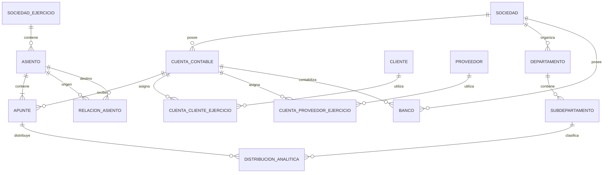

# Propuesta para el resto de tablas `F_*`

## Alcance

Este documento propone el tratamiento de todas las tablas materializadas cuyo
nombre comienza por `F_`, excepto `F_NOM`, que pertenece a la exportación
automatizada de nóminas creada en ProConta y no al modelo de ContaSol.

Las tablas ya diseñadas en documentos anteriores se incluyen únicamente para
mantener un inventario completo:

- `F_APU`, `F_DIA`, `F_OAS` y las tablas auxiliares de asiento;
- `F_IVS` y `F_IVR`;
- `F_CLI`, `F_PRO`, `F_MAE`, `F_EMP`;
- el resto de tablas sin propuesta previa.

No se modifica la estructura de la base. Las decisiones de “suprimir” significan
que la tabla no tendrá equivalente en el nuevo modelo; los datos originales se
conservarán durante la convivencia y sólo se retirarán después de validar la
migración.

El esquema se diseña desde el principio para una única base con todos los
ejercicios. La primera carga de datos abarcará únicamente el ejercicio en curso;
los ejercicios anteriores se incorporarán posteriormente desde sus respectivas
bases de ContaSol, reutilizando las mismas reglas y claves de
`SociedadesEjercicios`.

## Inventario y destino resumido

| Tabla | Filas | Decisión | Destino |
|---|---:|---|---|
| `F_347` | 0 | Suprimir | Modelo 347 calculado desde facturas, IVA y clientes/proveedores. |
| `F_349` | 0 | Suprimir | Modelo 349 calculado desde los registros fiscales. |
| `F_Anulacion_Asientos` | 2 | Suprimir | Sin destino. |
| `F_APU` | 2.713 | Transformar | `Asientos` + `Apuntes`. |
| `F_APUMANUAL` | 512 | Absorber | Campos de cabecera de `Asientos`. |
| `F_BAN` | 4 | Transformar | `Bancos`, con cuenta contable por sociedad. |
| `F_CDP` | 57 | Transformar | Nodos hijos de `CentrosCoste`. |
| `F_CLI` | 73 | Transformar | `Clientes` + `CuentasClientesEjercicio`. |
| `F_CLIAGRUPADOS` | 89 | Suprimir | El mayor permite seleccionar varias cuentas desde la interfaz. |
| `F_DEP` | 4 | Transformar | Nodos raíz de `CentrosCoste`. |
| `F_DIA` | 1 | Suprimir | Sin series ni contador separado. |
| `F_EFC` | 0 | Suprimir | Sin destino; futuros cobros usarán vencimientos/tesorería. |
| `F_EFP` | 0 | Suprimir | Sin destino; futuros pagos usarán vencimientos/tesorería. |
| `F_EMP` | 1 | Suprimir | Se usan las sociedades del nuevo subsistema. |
| `F_IVR` | 162 | Transformar | `IVARepercutido` + desgloses. |
| `F_IVS` | 159 | Transformar | `IVASoportado` + desgloses. |
| `F_MAE` | 2.323 | Transformar | `CuentasContables`, maestro único por sociedad. |
| `F_NOM_ALIAS` | 14 | Renombrar | `CabecerasNominas`. |
| `F_OAS` | 946 | Absorber | Cabecera `Asientos`. |
| `F_PRO` | 412 | Transformar | `Proveedores` + `CuentasProveedoresEjercicio`. |
| `F_SAL` | 542 | Suprimir | Saldos calculados desde `Apuntes`. |

## Diagrama de las entidades que permanecen

## Tablas de asientos

### `F_APU` → `Asientos` y `Apuntes`

Se mantiene la decisión ya aprobada:

- `ASIAPU` se convierte mediante mapa de identidad en `Asientos.IdAsiento Long`;
- `FECAPU` pasa una sola vez a `Asientos.Fecha`;
- `CONAPU` permanece como descripción de línea cuando varíe entre apuntes;
- `IMEAPU` pasa a `ImporteDebe` si `D-HAPU` indica Debe, o a `ImporteHaber` si
  indica Haber; la columna contraria queda `NULL`;
- `CUEAPU` pasa a `Apuntes.CuentaContable` y se valida contra
  `CuentasContables` de la sociedad del asiento;
- `ORDAPU` pasa a `Apuntes.Orden`;
- `DOCAPU` pasa a `Apuntes.NumeroFactura`;
- `PUNAPU` no se migra; el punteo se resuelve mediante otra mecánica;
- `DEPAPU` y `SUBAPU` generan la distribución analítica;
- `IMAAPU` pasa a `Apuntes.Documento` y contiene la ruta al PDF de la factura de
  compra o venta;
- `CIVAPU`/`TIVAPU` se convierten en relaciones con el registro fiscal;
- `UCRAPU`/`FCRAPU` y `UUMAPU`/`FUMAPU` alimentan la auditoría de cabecera tras
  escoger el valor cronológicamente más moderno dentro del asiento;
- `IMPAPU`, `MONAPU`, `DIAAPU`, `GUIDAPU`, `UKBAPU` y `TRZAPU` no se migran.

`MONAPU` vale `E` en los 2.713 registros y `UKBAPU` vale cero en todos ellos;
por tanto no aportan información variable. La moneda euro queda implícita en el
libro actual y podrá hacerse explícita en el asiento sólo si aparece un caso
multidivisa real.

Los campos de usuario y fecha de creación/modificación se consolidarán en la
cabecera. Si las fechas de los apuntes de un asiento discrepan, se conservará
silenciosamente la más moderna, junto con el operador asociado a ese valor, sin
generar incidencia por esa discrepancia.

### `F_OAS` → `Asientos.Descripcion`

`F_OAS` es la cabecera de asiento que faltaba en `F_APU`. Sus 946 registros no
tienen duplicados ni huérfanos en la copia activa.

Correspondencia:

- `NASOAS` → mapa a `IdAsiento`;
- `TEXOAS` → `Asientos.Descripcion`;
- `FECOAS` se usa para comprobar `Asientos.Fecha`, no como segunda fecha;
- `DIAOAS` se descarta junto con los diarios.

Para los asientos sin `F_OAS`, la descripción se obtendrá mediante una regla
determinista: descripción común de los apuntes o, si difieren, la primera línea
por orden más una incidencia informativa.

### `F_Anulacion_Asientos`

Se suprime sin migración ni tabla equivalente. Sus dos registros no condicionan
el modelo nuevo.

### `F_APUMANUAL` → `Asientos`

`F_APUMANUAL` fue creada en ProConta para identificar los asientos realizados
manualmente, documentar su motivo y permitir operaciones de alto nivel como
invertir Debe/Haber. No es otro libro de apuntes: el resultado contable ya está
en `F_APU`.

La tabla desaparece y queda absorbida por la cabecera `Asientos`:

| `F_APUMANUAL` | `Asientos` | Tratamiento |
|---|---|---|
| `ASIAPU` + `Ejercicio` | `IdAsiento` | Resolver mediante el mapa de identidad del ejercicio. |
| `TipoApunte` | `TipoAsientoManual` | Nullable; `NULL` identifica un asiento automático. |
| `Notas` | `Notas` | Información libre del asiento; el mismo campo admite notas de asientos automáticos. |
| `Operador` | `OperadorCreacion` | Conservar cuando exista. |
| `TimeStamp` | `FechaHoraCreacion` | Conservar como auditoría. |
| `Fecha` | sin destino | La fecha contable procede de `F_APU`. |
| `CuentaOrigen`, `CuentaDestino`, `Importe`, `DebeHaber` | sin destino | No se migran. |
| `CampoReferencia`, `ValorReferencia` | sin destino | No se migran. |

`TipoAsientoManual` se implementará como valor cerrado de dominio con los tipos
que resulten de traducir `TipoApunte`. Un asiento manual debe tenerlo informado;
un asiento automático debe tenerlo a `NULL`. `Notas` será opcional y podrá
contener información añadida tanto a asientos manuales como automáticos.

En esta fase sólo se migran filas del ejercicio en curso, resolviendo
`ASIAPU` contra ese mismo `SociedadEjercicio`. Las filas de ejercicios anteriores
se dejan intactas hasta abordar la migración de cada base histórica. Los campos
libres y contables expresamente descartados no generan incidencias.

## Plan contable

### `F_MAE` → `CuentasContables`

De `F_MAE` sólo se conservarán los campos que tienen significado funcional
confirmado. La nueva tabla propuesta contiene:

| Campo | Origen | Descripción |
|---|---|---|
| `IdCuentaContable` | nuevo | Clave técnica `Long` del maestro. |
| `IdSociedad` | contexto de base/tabla | Sociedad propietaria. |
| `CuentaContable` | `CODMAE` | Código textual, conservando ceros iniciales. |
| `Nombre` | `NOMMAE` | Nombre de la cuenta. |
| `Descripcion` | `NEXMAE` | Descripción ampliada de la cuenta. |
| `IdCentroCostePredeterminado` | `DEPMAE` + `SUBMAE` | Nodo analítico predeterminado resuelto dentro de la misma sociedad; nulo si ambos valores están vacíos. |

Único `(IdSociedad, CuentaContable)`. `DEPMAE` y `SUBMAE` son valores
predeterminados: ayudan a proponer la imputación de un apunte, pero no sustituyen
la analítica realmente registrada en éste. El nodo debe pertenecer a la sociedad
del ejercicio y estar marcado como imputable.

El resto de campos de `F_MAE` queda fuera de la migración. No se derivarán ni se
copiarán naturaleza, nivel, jerarquía o indicadores con significado no confirmado.

No habrá réplica ni tabla puente por ejercicio. Corregir `Nombre`, `Descripcion`,
centro de coste predeterminado afectará intencionadamente a la
visualización de todos los ejercicios de la sociedad. Esto no cambia los
importes ni el significado fiscal de los apuntes. El código de una cuenta usada
no se podrá cambiar ni reutilizar para otro concepto.

## Clientes y proveedores

### `F_CLI` → `Clientes`

`F_CLI` no se replica. Se reconcilia con la tabla `Clientes` ya utilizada por
facturación:

- código y cuenta (`CODCLI`) → `CuentasClientesEjercicio`;
- nombre, nombre comercial, NIF, dirección, país, teléfono y correo → maestro;
- tipo de operación y configuración fiscal → configuración fiscal del cliente;
- departamento/subdepartamento → centro de coste predeterminado, no dato
  identificativos;
- campos vacíos inventariados → sin destino.

Los datos emitidos en facturas permanecen congelados en cada factura; modificar
el cliente no reescribe históricos.

### `F_PRO` → `Proveedores`

Se aplica la misma estrategia, separada de clientes:

- `CODPRO` → `CuentasProveedoresEjercicio`;
- identidad, dirección, país y contacto → `Proveedores`;
- tipo de operación, deducibilidad y retención predeterminada → configuración
  fiscal del proveedor;
- forma de pago y cuenta bancaria → relaciones específicas;
- departamento/subdepartamento → centro de coste predeterminado;
- campos vacíos → sin destino.

La coincidencia de NIF ayuda a reconciliar, pero no decide automáticamente una
fusión.

### `F_CLIAGRUPADOS`

Se suprime sin migración. Su único objetivo era consultar conjuntamente el mayor
de varias subcuentas; esa selección múltiple ya está resuelta en la interfaz del
mayor, por lo que sus 89 filas no representan relaciones de dominio.

## Analítica

### `F_DEP` y `F_CDP` → `CentrosCoste`

- `CODDEP` → `Codigo`;
- `DENDEP` → `Nombre`;
- `OBSDEP` → `Descripcion`.

Cada fila de `F_DEP` crea un nodo raíz permanente por sociedad. `Codigo`
conserva el código funcional visible de `CODDEP`; no se transforma para hacerlo
más descriptivo. El nodo será imputable si existen cuentas o apuntes asociados
directamente al departamento sin un nivel inferior.

Cada fila de `F_CDP` crea un nodo hijo:

- `DEPCDP` → resolución de `IdCentroCostePadre`;
- `CODCDP` → código dentro del departamento;
- `DENCDP` → nombre;
- `OBSCDP` → descripción.

Los 57 registros contienen padre, código y nombre; por tanto no se descartan.
El importador calcula `Nivel`, `RutaJerarquica`, `RutaOrden` e
`IdCentroCosteRaiz` con las mismas reglas que el gestor nativo. Los apuntes
resuelven `DEPAPU` y `SUBAPU` a un único `IdCentroCoste`; si sólo existe
departamento se asigna el nodo raíz cuando sea imputable.

## Bancos

### `F_BAN` → `Bancos`

Sólo se conservarán los tres campos confirmados:

| Campo nuevo | Origen | Finalidad |
|---|---|---|
| `IdBanco` | `CODBAN` | Identificador del banco. Se validará su conversión a `Long`; si el código no fuese numérico se documentará antes del esquema físico. |
| `IdSociedad` | contexto de base/tabla | Sociedad propietaria del banco. |
| `Nombre` | `NOMBAN` | Nombre reconocible del banco. |
| `CuentaContable` | `CCOBAN` | Cuenta contable asociada; deberá existir en el plan del ejercicio cuando se use para contabilizar. |

Único `(IdSociedad, IdBanco)`. El resto de campos de `F_BAN`, incluidas
`VE1BAN`, `VE2BAN` y `FALBAN`, queda fuera de la migración. La configuración N43
podrá referenciar `Bancos`, pero no amplía por sí sola esta entidad con datos no
confirmados.

## Modelos informativos

### `F_347` y `F_349`

Ambas tablas están vacías y no tienen comportamiento de escritura vigente.
`F_347` sólo aparece como referencia externa en consultas que comparan resultados
calculados; `F_349` no aparece en el VBA o las consultas exportadas.

No se crean tablas equivalentes. Los modelos se obtendrán de:

- facturas y registros de IVA;
- `IncluidoModelo347` materializado;
- identificación fiscal y país del cliente/proveedor;
- `TiposOperacion` y período de liquidación.

Si en el futuro se genera una declaración, se podrá guardar una instantánea de
presentación con ejercicio, versión, estado y fichero, pero no una réplica de las
columnas de ContaSol.

## Efectos comerciales

### `F_EFC` y `F_EFP`

Las dos tablas están vacías y no aparecen utilizadas en el código exportado.
Representan previsiblemente efectos a cobrar y a pagar de ContaSol, pero no hay
datos que migrar ni un comportamiento que caracterizar.

Se suprimen sin destino. Las necesidades futuras se cubrirán mediante:

- vencimientos de facturas;
- movimientos de tesorería;
- aplicaciones de cobros/pagos;
- conciliación bancaria.

No se diseñarán entidades preventivas hasta aparecer un caso de uso real.

## Saldos

### `F_SAL`

`F_SAL` almacena Debe y Haber acumulados en columnas mensuales `ED0..ED14` y
`EH0..EH14`; toda la familia `PD*`/`PH*` está vacía y los períodos 8–14 tampoco
tienen importes en la copia. El código borra y reconstruye la tabla desde
`F_APU`, por lo que no es fuente de verdad.

Se elimina sin migración ni tabla equivalente. Diario, mayor y saldos se
calculan desde `Apuntes`, con índices por cuenta/asiento y asiento/fecha. No se
usará `F_SAL` ni tablas de saldo derivadas para comprobar la migración. Si el
volumen real demostrase un problema, se diseñaría entonces una caché
reconstruible.

## Sociedad y diario

### `F_EMP`

Se suprime sin migración. La sociedad y el ejercicio proceden exclusivamente de
`Sociedades` y `SociedadesEjercicios` del nuevo subsistema. `F_EMP` no participará
ni siquiera como fuente preferente de identidad; cualquier dato legal útil se
contrastará manualmente con el nuevo maestro.

### `F_DIA`

Se suprime. Sólo contiene una fila y la copia usa un único `DIAAPU`. El
autonumérico `Long` de `Asientos` sustituye `ASIDIA`; no hay series, números
especiales ni reaprovechamiento de huecos.

## Integración de nóminas

Este subsistema fue creado en ProConta y no procede de ContaSol. Se conserva,
pero adopta nombres inteligibles y separa claramente sus tres fases:

1. importar el resumen Excel y mapear sus cabeceras;
2. almacenar una nómina normalizada por trabajador y período;
3. generar el asiento mediante una plantilla.

### `F_NOM` → `Nominas`

`Nominas` almacena una nómina por fila. Sus 157 registros se migrarán conservando
sociedad, período, trabajador, importes salariales, costes, cuenta contable y
departamento. `ASIAPU` se convierte en `IdAsiento Long` nullable con relación a
`Asientos`.

Se añadirá una clave técnica `IdNomina Long` y una clave alternativa única
`(IdSociedad, Fecha, IdTrabajador)`. Una fila importada con la misma sociedad,
fecha y trabajador que otra existente es un duplicado. Las nóminas ordinarias
usan el día 25 y las pagas extra el día 15, lo que permite dos nóminas del mismo
trabajador en un mes sin incluir `TipoPaga` en la clave. Los importes mantendrán
nombres de dominio y descripción en Access.

### `F_NOM_ALIAS` → `CabecerasNominas`

Sus 14 filas actuales están confirmadas como el mapeo válido utilizado en
producción para traducir el texto de una cabecera del Excel al campo destino de
`Nominas`. Las 14 se migrarán sin eliminar ni añadir correspondencias:

| Campo nuevo | Origen | Finalidad |
|---|---|---|
| `IdCabeceraNomina` | nuevo | Clave técnica `Long`. |
| `Alias` | `Alias` | Texto reconocido en la cabecera del Excel. |
| `CampoNomina` | `Campo` | Campo permitido de `Nominas` al que se asigna la columna. |
| `EstaActiva` | nuevo | Permite retirar un alias sin borrarlo. |

`Alias` normalizado será único. `CampoNomina` no admitirá cualquier texto: se
validará contra una lista blanca de campos importables para evitar que una
cabecera Excel termine construyendo SQL dinámico arbitrario.

Otras tablas auxiliares no sustituirán este conjunto confirmado. Cualquier alias
nuevo se incorporará después de la migración mediante la operativa normal y con
validación contra la lista blanca.

### `PlantillasApuntes`

Contiene el esquema de generación de apuntes desde `Nominas`. Sus 14 reglas se
mantienen como configuración, renombrando sus campos cuando se diseñe el esquema
físico:

- sociedad y `TipoApunte` seleccionan la plantilla;
- `Orden` fija el orden del apunte generado;
- `FormulaDescripcion`, `FormulaCuenta` y `FormulaImporte` calculan sus valores;
- `DH` determina Debe/Haber;
- `AgruparApuntes` controla la agregación;
- `Condicion` decide si la regla se aplica.

Cada ejecución genera un único `Asiento` automático con sus `Apuntes` y enlaza
las `Nominas` incluidas mediante `Nominas.IdAsiento`. La generación será atómica
e idempotente: reintentar la misma sociedad/período no duplica el asiento. Para
rehacerlo se crea la operación contable prevista y se actualiza el vínculo sólo
dentro de la misma transacción.

Las fórmulas heredadas no se ejecutarán directamente como expresiones Access ni
mediante evaluación libre. Se inventariarán y traducirán a un lenguaje de
expresiones limitado, validado y probado.

## Orden propuesto de migración

1. Crear perfilados y mapas de identidad por sociedad/ejercicio.
2. Migrar `F_MAE` al plan contable.
3. Reconciliar clientes y proveedores; `F_CLIAGRUPADOS` no se migra.
4. Migrar la jerarquía de centros de coste.
5. Crear cabeceras desde `F_OAS`/`F_APU` y después sus apuntes.
6. Absorber los metadatos de asientos manuales del ejercicio en curso;
   `F_Anulacion_Asientos` no se migra.
7. Migrar los libros de IVA y verificar sus enlaces con factura/asiento.
8. Reconciliar bancos de `F_BAN` con la configuración N43.
9. Comparar mayores, balances, 303, 347 y 349 sin utilizar `F_SAL`.
10. Migrar `Nominas`, consolidar `CabecerasNominas` y caracterizar las reglas de
    `PlantillasApuntes`.
11. Marcar como sólo lectura y retirar gradualmente las tablas sin destino.

## Pruebas de caracterización

- toda cuenta utilizada por un apunte existe en el plan del ejercicio;
- `CuentaContable`, `Nombre`, `Descripcion` y centro de coste predeterminado de
  cada cuenta coinciden con los campos conservados de `F_MAE`;
- cada `F_OAS` produce exactamente una cabecera y conserva su texto;
- cada registro manual localiza su asiento por ejercicio e identificador y
  conserva tipo, notas y auditoría en la cabecera;
- clientes y proveedores conservan las cuentas que les correspondan sin usar
  `F_CLIAGRUPADOS`;
- todos los centros usados por apuntes y facturas se resuelven;
- cada centro y todos sus antecesores pertenecen a la misma sociedad;
- cada `F_BAN.CCOBAN` corresponde a una cuenta contable válida;
- mayor por cuenta y mes coincide con los apuntes legados, sin contrastar
  `F_SAL`;
- resultados 347/349 se generan sin depender de sus tablas vacías;
- importar dos veces el mismo Excel no duplica nóminas;
- las 14 filas actuales de `F_NOM_ALIAS` se migran exactamente una vez y producen
  el mismo mapeo de cabeceras;
- generar dos veces el mismo período no duplica el asiento de nóminas;
- cada regla de `PlantillasApuntes` produce los apuntes esperados;
- repetir la migración no duplica ninguna entidad.

## Decisiones pendientes

1. Definir la política para sustituir un asiento de nóminas ya generado cuando
   se corrija y reimporte deliberadamente una nómina existente.
