# Mapa de módulos, capacidades e hilos de ProConta

Fecha de actualización: 30/09/2026. Estado: **primer roadmap acordado y nombres aplicados; resto del mapa propuesto**.
Responsable del mapa: Auditor. Responsable de coordinación operativa: Orquestador.

## Actualización de normalización — 01/10/2026

Normalizados en la aplicación los hilos GOV-AUD, DAT-TERCEROS, TES-N43,
CFG-MANT, UI-BASE, UI-PRINCIPAL, FAC-LIS, FAC-DET, INF-COR e INF-DIS.
Los títulos exactos y las identidades estables están en REGISTRO_HILOS.json.
La normalización de nombres no certifica integración ni aceptación visual.

DOC-GESTOR · Gestión documental: hilo `01a0f6ee-afa9-7101-b599-97fa421a3359`.
Posee identidad, ubicación y vinculaciones de Documentos; los módulos de origen
mantienen el significado funcional. [Contrato inicial](contratos/DOC-GESTOR.md).
Su worktree de implementación aún está pendiente; el contrato reside aquí.
Fichero será relativo a raíz configurable, por defecto Documentos junto a la
aplicación. No se migran documentos ni vínculos documentales legados.

Correo: [decisiones funcionales del 01/10](ACUERDOS_CORREO_20261001.md).
INF-COR posee composición/consulta/seguimiento; INF-DIS coordina procesamiento.
La ampliación saliente durable está pendiente, no se presupone implementada.

## Primer roadmap acordado — 30/09/2026

Los siguientes nombres ya están aplicados. Los prefijos son únicos y estables; no expresan jerarquía entre hilos ni prioridad permanente.

| Orden | Hilo |
|---|---|
| 0 | UI-BASE · Base visual y componentes WPF |
| 1 | CFG-GLOBAL · Configuración global de datos |
| 2 | SEG-ACCESO · Autenticación, permisos y entorno |
| 3 | UI-PRINCIPAL · Aplicación principal y navegación WPF |
| 4 | DAT-TERCEROS · Modelo y gestión de terceros |
| 5 | CFG-MANT · Mantenimiento genérico de parámetros y tablas auxiliares |

UI-BASE posee recursos visuales y componentes reutilizables. UI-PRINCIPAL posee la composición, arranque y navegación de la aplicación, consumiendo los contratos funcionales sin duplicarlos. Orquestador conserva la coordinación operativa. CFG-MANT es un módulo funcional genérico, no una categoría para separar todas las pantallas de sus módulos.

Se acuerda una nueva aplicación WPF conservando la anterior y reutilizando servicios, dominio y persistencia. ActualizadorEsquema es una dependencia de compatibilidad del arranque. El contenedor mínimo y los auxiliares necesarios se preparan cuando lo requiera el recorrido, sin esperar al cierre secuencial de todos los puntos.

Cierre funcional de esta fase: arrancar, abrir una BD compatible, autenticarse, seleccionar entorno y gestionar terceros y auxiliares. Después: Conceptos, preparación de facturas, emisión VeriFactu y documento; contabilidad automatizada progresiva posteriormente.

Los dos hilos nuevos se han creado en C:/Docs/VeriFactu solo para establecer contexto. No tienen worktree ni rama de implementación asignados todavía. El hilo existente «Diseñar pantallas WPF estandarizadas» (01a0f182-bf1a-7640-bf05-d928401dd316) sigue siendo referencia de prototipos; no se ha renombrado ni duplicado su cometido.
## Qué resuelve este mapa

Un hilo puede descubrir su responsabilidad, documentación, dependencias y conversaciones relacionadas sin deducirlas de su título. Las áreas siguientes organizan el producto: no crean proyectos de Visual Studio, proyectos de Codex, worktrees ni nuevos hilos.

El mapa distingue:

- **Acuerdo:** confirmado en instrucciones del usuario o contratos de los hilos.
- **Observado:** existe en archivos/historial, sin afirmar aceptación o integración completa.
- **Propuesta:** asignación recomendada por el Auditor; no cambia reglas vigentes.
- **Pendiente:** falta propietario o contrato suficientemente preciso.

El inventario legible está en este documento. [REGISTRO_HILOS.json](C:/Docs/VeriFactu/ProConta.Facturacion/docs/REGISTRO_HILOS.json) permite consultar identificadores, títulos exactos, rutas, ramas, documentos y relaciones. Ambos deben actualizarse juntos. Los códigos FAC, CON, INF, etc. son claves internas de este mapa; no son nombres impuestos a clases ni títulos nuevos.

## Vista funcional propuesta

```mermaid
flowchart TD
    P[ProConta] --> D[Datos maestros]
    P --> F[Facturación]
    P --> C[Compras]
    P --> K[Contabilidad]
    P --> N[Nóminas]
    P --> A[Activos]
    P --> T[Tesorería]
    P --> S[Capacidades transversales]
    P --> I[Implantación]
    D --> DT[Terceros y funciones]
    D --> DO[Sociedades, ejercicios y catálogos comunes]
    F --> FC[Conceptos]
    F --> FF[Facturas, series y rectificación]
    F --> FP[Contratos y programaciones]
    F --> FR[Reservas de alojamiento]
    F --> FV[Integración VeriFactu]
    K --> KC[Cuentas]
    K --> KA[Asientos y mayor]
    K --> KG[GestorContable]
    K --> KM[Modelos contables]
    K --> KI[Asistente de asientos]
    T --> TN[Norma 43]
    T --> TP[Cobros, pagos y conciliación: alcance pendiente]
    S --> SC[Correo y Dispatcher]
    S --> SR[Reporting y Gráficos]
    S --> SI[Configuración, Seguridad, UI y ActualizadorEsquema]
    I --> IE[MigradorERP]
    I --> IC[Importador ContaSol]
```

**Conceptos es una capacidad de Facturación en esta propuesta.** Abrir un hilo para desarrollarla no requiere convertirla en un motor independiente. Facturas WPF y DetalleFactura WPF son trabajos de presentación del mismo dominio, no nuevos propietarios de facturas.

**Tesorería es una agrupación de responsabilidades**, no una afirmación de que exista un motor completo de conciliación, pagos o remesas. **Datos maestros** tampoco exige crear ahora un proyecto común ni un hilo padre.

## Responsabilidades y referencias

| Área / capacidad | Propietario funcional y frontera | Hilo o referencia | Situación |
|---|---|---|---|
| Gobierno arquitectónico | Mapa, límites, riesgos y decisiones compartidas | GOV-AUD | Acuerdo de este hilo |
| Coordinación operativa | Encargos, secuencia, integración y cierres | GOV-ORQ | Acuerdo |
| Terceros y funciones | Identidad, datos comunes, domicilios, contactos y alta de funciones Cliente/Proveedor/Contacto | DAT-TERCEROS | Acuerdo del usuario y contrato nuevo |
| Sociedades y ejercicios | Identidad organizativa y configuración anual; el cierre se opera por Asientos | Contrato de ActualizadorEsquema; responsable funcional propuesto: configuración organizativa | Contrato observado; titular funcional por ratificar |
| Conceptos | Catálogo facturable, valores actuales y referencias de impuestos/cuenta/analítica | Facturación; sin hilo exclusivo identificado | Propuesta de ubicación; hay implementación previa |
| Facturas, series y rectificación | Ciclo fiscal, numeración, instantáneas e inmutabilidad | Núcleo Facturación; FAC-LIS y FAC-DET cubren vistas; FAC-VF cubre integración | Código observado; no designar a una vista como propietario del dominio |
| Contratos y programaciones | Condiciones de facturación y generación periódica; referencias a Cliente y Activo | Núcleo Facturación | Código observado; no se ha resuelto un hilo exclusivo vigente |
| Reservas de alojamiento | Reservas y lotes que preparan facturación; los inmuebles siguen en Activos | FAC-RES | Contrato explícito; emisión todavía pendiente de decisiones en su hilo |
| VeriFactu | Traducción y comunicación detrás de interfaz; estados fiscales definidos con Facturación | FAC-VF | Observado; separar en sus entregas PDF y comunicación fiscal |
| Compras | Factura recibida, reconocimiento, revisión y propuesta de contabilización | COM; COM-H conserva análisis y conversación posterior | Continuidad técnica identificada; evitar dos líneas de implementación |
| Cuentas | Identidad/cuenta por ejercicio, imputabilidad y correspondencias contables de funciones | CON-CUE | Contrato existente, compatible con Terceros según su hilo |
| Asientos | Cabeceras/apuntes, lotes, mayor, invariantes y cierre transaccional | CON-ASI | Contrato existente; consumidores aún por converger |
| GestorContable | Propuestas y procesos de IVA, prorrata, IS, cierre y reapertura | CON-GES | Consume Asientos, Cuentas y Seguridad |
| Modelos contables | Cálculos y trazabilidad por modelo/ejercicio | CON-MOD | Separado de render y de presentación externa |
| Asistente de asientos | Propuestas asistidas; confirma a través de las reglas contables | CON-IA | Capacidad de Contabilidad; no dueño alternativo de Asientos |
| Nóminas | Empleados, importaciones y valores salariales; propone contabilización | NOM | No equivale a motor completo de cálculo laboral; adaptar escritura a Asientos |
| Activos | Bienes, inmuebles, inversiones, operaciones y relaciones de cuentas | ACT | Catálogo del bien separado de su facturación |
| Norma 43 | Importación de extractos/movimientos, identidad y reversión de lotes | TES-N43 | No acredita conciliación integral |
| Cobros/pagos/remesas/conciliación | Estados de tesorería y relaciones con documentos y asientos | Sin responsable completo identificado | Pendiente de delimitar; no encargarlo implícitamente a Norma 43 |
| Gestor Correo | Cuentas, credenciales y transporte | INF-COR | Separación ya implementada en su rama |
| Mail Dispatcher | Comandos, adjuntos, coordinación de consumidores e idempotencia funcional | INF-DIS | Consume Gestor Correo |
| Reporting | Plantillas, render y exportación de resultados | INF-REP | Las reglas contables pertenecen al módulo que calcula |
| Gráficos | Contratos visuales y adaptación del motor gráfico | INF-GRA | Los consumidores calculan las magnitudes de negocio |
| Configuración de ubicación | Resolución de directorio/base y modo desatendido | CFG-GLOBAL | No propietario de todas las reglas mostradas en Configuración |
| Pantalla de Configuración | Registro y edición visual de opciones aportadas por módulos | CFG-GLOBALUI | Infraestructura UI, no un dominio de negocio |
| Seguridad | Operadores, grupos, autenticación, permisos y auditoría de seguridad | SEG-ACCESO | No fusionar automáticamente Operador con Tercero |
| ActualizadorEsquema | Esquema físico reproducible, manifiestos, diagnóstico y evolución | INF-ESQ | Hilo nuevo vigente; no decide solo las reglas del negocio |
| MigradorERP | Cobertura y ejecución del traslado de la instalación ERP | MIG-ERP | Los módulos validan sus transformaciones |
| Importador ContaSol | Implantación desde bases por empresa/ejercicio | MIG-CS | Independiente del traslado ERP |

### Límites que deben consultar varios módulos

| Dato u operación compartida | Propietario / propuesta | Qué hacen los demás |
|---|---|---|
| Nombre, NIF y domicilio común | Terceros — acuerdo | Consultan la identidad; las funciones conservan sus IDs propios. |
| Datos específicos de Cliente/Proveedor/Contacto | Modelo de funciones de Terceros — acuerdo; reglas de negocio específicas con Facturación/Compras | Evitan duplicar datos comunes. Un cambio funcional requiere revisar consumidores, no solo la ficha. |
| Cuenta contable de cliente/proveedor por ejercicio | Cuentas — contrato observado | Mantienen IdCliente/IdProveedor; no añaden una cuenta única a Terceros. |
| Instantánea fiscal de factura emitida | Facturación — acuerdo | Los cambios en Terceros no actualizan documentos emitidos. |
| Sociedad/ejercicio | Configuración organizativa — propuesta | Toda operación declara su contexto; ActualizadorEsquema materializa el contrato. |
| Estado EjercicioCerrado | Asientos — contrato observado | Ningún escritor puede saltarse el cierre por pertenecer a otro módulo. |
| Centros de coste y jerarquía analítica | Cuentas/analítica contable — propuesta | Nóminas, Activos y Facturación referencian el centro; ContaSol aporta mapas de importación. |
| Tratamiento de IVA/prorrata del centro | GestorContable — contrato observado | La existencia del centro no atribuye sus reglas fiscales al editor del catálogo. |
| Impuestos aplicables al concepto y línea | Facturación en ventas; Compras en recibidas — propuesta de delimitación | El catálogo común no duplica las reglas de cada operación; cambios transversales se coordinan. |
| Inmueble/activo | Activos — contrato observado | Reservas y Contratos mantienen referencias a IdActivo, sin una segunda ficha del inmueble. |
| Forma de pago | Catálogo organizativo común — propuesta | Facturación usa su valor predeterminado; una forma de pago no registra un cobro. |
| Archivo original/documento generado | DOC-GESTOR para almacenamiento/vínculos; módulo originador para significado; Reporting para render | DOC-GESTOR creado y autorizado: identidad, almacenamiento y vínculos documentales. Contrato inicial publicado; implementación pendiente. |
| Esquema y datos importados | ActualizadorEsquema para estructura; importador para ejecución; módulo para transformación — propuesta de gobierno | Evitar DDL rival y no dar por válida una carga solo porque encaja físicamente. |

Empleados y Operadores conservan por ahora sus identidades actuales. El contrato de Terceros recibido cubre Cliente, Proveedor y Contacto; ampliarlo a empleados u operadores sería otra decisión. No hay motivo para bloquear el mapa ni migrar esas identidades por anticipado.

## Documentos para empezar a trabajar

Estos enlaces apuntan a archivos existentes, no todos integrados ni confirmados en Git. El encabezado de cada contrato y su historial determinan su estado. ActualizadorEsquema y Terceros estaban trabajando durante la toma del mapa; sus resultados no se certifican aquí.

| Ámbito | Referencia |
|---|---|
| Arquitectura general y hallazgos iniciales | [Auditoría global](C:/Docs/VeriFactu/ProConta.Facturacion/docs/AUDITORIA_GLOBAL.md) |
| Modelo de Facturación | [Modelo de factura](C:/Docs/VeriFactu/ProConta.Facturacion/docs/MODELO_FACTURA.md) y [decisiones históricas](C:/Docs/VeriFactu/ProConta.Facturacion/docs/DECISIONES.md) |
| Cambios propuestos en Conceptos y programaciones | [Centros y Facturación](C:/Docs/VeriFactu/ProConta.ActualizadorEsquema/docs/actualizador-esquema/CENTROS_Y_FACTURACION.md) |
| Terceros | [Contrato de identidad y adopción](C:/Docs/VeriFactu/ProConta.Terceros/docs/TERCEROS_CONTRATO.md) |
| Sociedad/ejercicio | [Contrato de sociedades](C:/Docs/VeriFactu/ProConta.ActualizadorEsquema/docs/actualizador-esquema/SOCIEDADES_Y_EJERCICIOS.md) |
| Reservas | [Contrato de reservas](C:/Docs/VeriFactu/ProConta.Facturacion/docs/RESERVAS_ALOJAMIENTO_CONTRATO.md) |
| Compras | [Estado de reconocimiento](C:/Docs/VeriFactu/ProConta.FacturasCompra/docs/ESTADO_RECONOCIMIENTO_FACTURAS_COMPRA.md) y [contrato físico propuesto](C:/Docs/VeriFactu/ProConta.ActualizadorEsquema/docs/actualizador-esquema/FACTURAS_COMPRA.md) |
| Contabilidad | [GestorContable](C:/Docs/VeriFactu/ProConta.GestorContable/docs/GESTOR_CONTABLE.md), [Modelos](C:/Docs/VeriFactu/ProConta.ModelosContables/docs/MODELOS_CONTABLES.md) y [contabilidad de la maestra](C:/Docs/VeriFactu/ProConta.ActualizadorEsquema/docs/actualizador-esquema/CONTABILIDAD_INICIAL.md) |
| Nóminas | [Interfaz y alcance](C:/Docs/VeriFactu/ProConta.Nominas/docs/INTERFAZ_NOMINAS_KRYPTON.md) |
| Norma 43 | [Motor Norma 43](C:/Docs/VeriFactu/ProConta.Norma43/docs/MOTOR_NORMA43.md) |
| Activos | [Modelo de activos](C:/Docs/VeriFactu/ProConta.Activos/docs/MODELO_ACTIVOS.md) |
| Correo | [Gestor Correo](C:/Docs/VeriFactu/ProConta.GestorCorreo/docs/GESTOR_CORREO.md) |
| Reporting / Gráficos | [Reporting](C:/Docs/VeriFactu/ProConta.Reporting/docs/REPORTING.md) y [Gráficos](C:/Docs/VeriFactu/ProConta.Graficos/docs/MOTOR_GRAFICOS.md) |
| Configuración | [Ubicación de datos](C:/Docs/VeriFactu/ProConta.ConfiguracionGlobal/docs/CONFIGURACION_DATOS.md) y [UI WPF](C:/Docs/VeriFactu/ProConta.WpfConfiguracion/docs/WPF_FACTURAS.md) |
| ActualizadorEsquema vigente | [Implementación inicial](C:/Docs/VeriFactu/ProConta.ActualizadorEsquema/docs/actualizador-esquema/IMPLEMENTACION_INICIAL.md) y [cobertura](C:/Docs/VeriFactu/ProConta.ActualizadorEsquema/docs/actualizador-esquema/COBERTURA_SUBMODELOS.md) |
| Traslado ERP | [Inventario y plan](C:/Docs/VeriFactu/ProConta.Migracion/docs/MIGRADOR_ERP.md) y [tablas](C:/Docs/VeriFactu/ProConta.Migracion/docs/MIGRADOR_ERP_TABLAS.md) |
| Importación ContaSol | [Protocolo](C:/Docs/VeriFactu/ProConta.ContaSol/docs/PROTOCOLO_IMPORTACION_CONTASOL.md) |

Hay divergencias entre documentos antiguos, manifiestos nuevos y código consumidor. Por ejemplo, el contrato nuevo hace Conceptos y Programaciones permanentes por sociedad, mientras consumidores existentes aún usan ejercicio. **Un manifiesto creado no significa que la aplicación esté adaptada.** Ante contradicciones, registrar el punto y consultar el contrato más reciente y el hilo propietario; no escoger una versión solo por su fecha.

## Registro de hilos y ubicaciones

Títulos copiados tal como los devuelven las herramientas. «Vigente» indica continuidad identificada, no actividad permanente ni funcionalidad terminada. Las rutas asignadas se han contrastado con Git/documentación; el directorio de arranque del chat puede ser otro. No escribir tomando el cwd como única evidencia.

| Clave | Título observado | Identificador | Carpeta de trabajo | Rama | Referencia de continuidad |
|---|---|---|---|---|---|
| GOV-AUD | GOV-AUD · Auditoría y arquitectura global | `01a0e6ec-6b63-74b3-bff4-a90df8a595b0` | [ProConta.Facturacion](C:/Docs/VeriFactu/ProConta.Facturacion) | `codex/integracion-proconta-20260822` | vigente |
| GOV-ORQ | Orquestador | `01a02903-4be4-74f2-afdf-a8292b08b40b` | Sin checkout asignado en este mapa | — | vigente |
| DAT-TERCEROS | DAT-TERCEROS · Modelo y gestión de terceros | `01a0ecfd-9332-7d73-ab9d-d79492aa73bf` | [ProConta.Terceros](C:/Docs/VeriFactu/ProConta.Terceros) | `feature/terceros` | vigente |
| FAC-RES | Facturación de reservas de alojamiento | `01a0ecee-124a-79b2-8c40-b69cf12d4aba` | [ProConta.Facturacion](C:/Docs/VeriFactu/ProConta.Facturacion) | `codex/integracion-proconta-20260822` | vigente |
| FAC-VF | Integración VeriFactu en ProConta | `01a0763a-f47e-7701-8c77-f9b343602581` | [ProConta.VeriFactu](C:/Docs/VeriFactu/ProConta.VeriFactu) | `codex/integracion-verifactu` | vigente |
| FAC-LIS | FAC-LIS · Facturas emitidas y programadas | `01a03500-a67d-7410-b1dc-3eb5f67c8b65` | [ProConta.WpfFacturas](C:/Docs/VeriFactu/ProConta.WpfFacturas) | `codex/wpf-facturas` | referencia de implementación |
| FAC-DET | FAC-DET · Detalle y edición de facturas | `01a03815-bbe1-7843-911f-5dc4f7f0f597` | [ProConta.WpfDetalleFactura](C:/Docs/VeriFactu/ProConta.WpfDetalleFactura) | `codex/wpf-detalle-factura` | referencia de implementación |
| COM | Motor Facturas de Compra — continuación… | `01a07b40-0d03-72b3-a3e9-e2a7ae2f6cd1` | [ProConta.FacturasCompra](C:/Docs/VeriFactu/ProConta.FacturasCompra) | `codex/facturas-compra` | continuación designada |
| COM-H | Motor importación facturas compra | `01a00ee8-d59f-7de0-9da6-74ec17350da3` | Sin checkout asignado en este mapa | — | histórico con conversación posterior; resolver continuidad |
| CON-CUE | Motor Cuentas Contables | `01a07b40-19a0-7d40-85e9-8530cfb64147` | [ProConta.CuentasContables](C:/Docs/VeriFactu/ProConta.CuentasContables) | `codex/cuentas-contables` | vigente |
| CON-ASI | Motor Asientos Contables | `01a07b3f-d7a5-7892-94a6-8dca3ccc37d6` | [ProConta.Asientos](C:/Docs/VeriFactu/ProConta.Asientos) | `codex/asientos` | vigente |
| CON-GES | GestorContable | `01a07af8-9926-7790-9776-b09857e46d01` | [ProConta.GestorContable](C:/Docs/VeriFactu/ProConta.GestorContable) | `codex/gestor-contable` | vigente |
| CON-MOD | Modelos contables | `01a034a6-626d-7d80-a999-386575c67679` | [ProConta.ModelosContables](C:/Docs/VeriFactu/ProConta.ModelosContables) | `codex/modelos-contables` | vigente |
| CON-IA | Asistente IA para Asientos — continuación… | `01a07b40-34f5-7273-a0eb-3afd31bf6804` | [ProConta.AsistenteAsientos](C:/Docs/VeriFactu/ProConta.AsistenteAsientos) | `codex/asistente-asientos` | continuación designada |
| NOM | Motor Nóminas | `01a07b3f-bccd-73f3-bae6-7bf227dbbaf4` | [ProConta.Nominas](C:/Docs/VeriFactu/ProConta.Nominas) | `codex/motor-nominas` | vigente |
| TES-N43 | TES-N43 · Extractos y líneas bancarias | `01a07b3f-e43b-7630-99fd-91c45619b108` | [ProConta.Norma43](C:/Docs/VeriFactu/ProConta.Norma43) | `codex/norma43` | vigente |
| ACT | Gestión de activos | `01a067ec-626d-7232-b61b-fbef4b252a6b` | [ProConta.Activos](C:/Docs/VeriFactu/ProConta.Activos) | `codex/activos` | vigente |
| CFG-GLOBAL | CFG-GLOBAL · Configuración global de datos | `01a07b3f-f0f5-75e2-988d-51543b318131` | [ProConta.ConfiguracionGlobal](C:/Docs/VeriFactu/ProConta.ConfiguracionGlobal) | `codex/configuracion-global` | vigente |
| CFG-GLOBALUI | CFG-MANT · Mantenimiento genérico de parámetros y tablas auxiliares | `01a03914-e923-7bd1-bdee-e44df0d20800` | [ProConta.WpfConfiguracion](C:/Docs/VeriFactu/ProConta.WpfConfiguracion) | `codex/wpf-configuracion` | sin título devuelto; referencia de implementación |
| SEG-ACCESO | SEG-ACCESO · Autenticación, permisos y entorno | `01a07b3f-cb00-7651-9d36-3bab014f82bb` | [ProConta.Seguridad](C:/Docs/VeriFactu/ProConta.Seguridad) | `codex/seguridad` | vigente |
| INF-COR | INF-COR · Gestión y seguimiento del correo | `01a07bce-2cbe-7c03-bb2f-427080a24b03` | [ProConta.GestorCorreo](C:/Docs/VeriFactu/ProConta.GestorCorreo) | `codex/gestor-correo` | vigente |
| INF-DIS | INF-DIS · Procesamiento de correo (Mail Dispatcher) | `01a07643-ebb8-7672-bd14-d26572c49cd2` | [ProConta.MailDispatcher](C:/Docs/VeriFactu/ProConta.MailDispatcher) | `codex/mail-dispatcher` | vigente |
| INF-REP | Motor Reporting | `01a07b40-0143-7463-b24b-6a27e6082f3e` | [ProConta.Reporting](C:/Docs/VeriFactu/ProConta.Reporting) | `codex/reporting` | vigente |
| INF-GRA | Motor Gráficos | `01a06c29-8e4e-7b53-bcee-3f0f1450e821` | [ProConta.Graficos](C:/Docs/VeriFactu/ProConta.Graficos) | `codex/graficos` | vigente |
| INF-ESQ | ActualizadorEsquema | `01a0e789-7bcf-7692-ab7b-53270a6f539e` | [ProConta.ActualizadorEsquema](C:/Docs/VeriFactu/ProConta.ActualizadorEsquema) | `codex/actualizador-esquema` | vigente |
| MIG-ERP | MigradorERP | `01a0e734-d237-7aa2-ae22-579d81e6cbc2` | [ProConta.Migracion](C:/Docs/VeriFactu/ProConta.Migracion) | `feature/migracion-proconta` | vigente |
| MIG-CS | Importador ContaSol | `01a07b40-273e-7130-b5c2-8936f05eb638` | [ProConta.ContaSol](C:/Docs/VeriFactu/ProConta.ContaSol) | `codex/contasol` | vigente |

### Historial que conserva contexto

No archivar ni fusionar conversaciones automáticamente. Se registran los antecedentes localizados, sin afirmar que sean todos.

| Título observado | Identificador | Continuidad |
|---|---|---|
| Old_ActualizadorEsquema | `01a0e738-aee0-7870-be65-adfadb496708` | sustituido por INF-ESQ |
| Motor Asientos Contables | `01a0233a-1262-7aa3-b5ca-e229db4675ea` | continuado en CON-ASI |
| Motor Norma 43 | `01a02451-3154-72a2-a1d0-81b15970cb10` | continuado en TES-N43 |
| SEG-ACCESO · Autenticación, permisos y entorno | `01a02a36-370c-7df0-829c-074af9f0197c` | continuado en SEG-ACCESO |
| Motor Nóminas | `01a0293e-ad15-78c1-8286-470c1369163a` | continuado en NOM |
| CFG-GLOBAL · Configuración global de datos | `01a02f65-b635-7352-a793-5e464af6a527` | continuado en CFG-GLOBAL |
| Motor Reporting v1 | `01a02a14-df1f-7541-be56-81220485a9c0` | continuado en INF-REP |
| Motor Reporting v2 | `01a03369-e787-74f0-8e5c-c2f609957f4f` | continuado en INF-REP |

El hilo de Configuración WPF devuelve título nulo; se conserva su ID y su encargo comprobado, sin inventar un título. En Compras hay una continuación designada, pero el hilo original tuvo conversaciones posteriores: COM es la referencia técnica propuesta y COM-H debe revisarse para recuperar decisiones más recientes antes de continuar.

QuickMail/EudoraMail y LEOC son referencias externas al mapa funcional de ProConta. La exploración de EudoraMail embebible no convierte a ese proyecto en propietario actual del correo: el Orquestador adoptó después Gestor Correo propio. No se integran aquí como módulos adicionales.

## Cómo encuentra un hilo su contexto

1. Consultar este mapa y el registro por clave funcional, ID o carpeta asignada; los títulos pueden cambiar.
2. Leer el contrato propio y las referencias de sus dependencias. No hace falta un hilo padre que reenvíe todo.
3. Comprobar rama, HEAD y cambios locales en el worktree asignado; identificar qué contratos pertenecen a otra rama.
4. Leer el hilo relacionado por ID cuando falte justificación, exista una contradicción o haya una decisión posterior. Que un chat esté inactivo no acredita que su entrega esté integrada.
5. Registrar en un documento la decisión aceptada con fecha, procedencia y consumidores afectados. Si se trata de una propuesta, mantenerla marcada como tal.
6. Comunicar cambios a otros hilos solo dentro de la coordinación autorizada por el usuario. Este mapa no concede permiso general para enviar mensajes, alterar módulos ajenos o ejecutar importaciones.

Para un futuro hilo de Conceptos, la ficha inicial sería: área Facturación; referencia funcional del núcleo de facturas; dependencias de Terceros solo donde haya datos de cliente, Cuentas y analítica para imputación, ActualizadorEsquema para estructura y MigradorERP para histórico. Los valores actuales del concepto no reescriben líneas históricas. No necesita un «hilo Facturación» nuevo como padre.

## Uso para la migración

MigradorERP conserva el inventario físico completo. Cada módulo valida las filas y campos de su bloque. Una tabla transversal tiene un propietario funcional único; los consumidores declaran dependencias y pueden ser corresponsables de validar referencias, pero no crean cargas paralelas.

La ficha de migración mínima contendrá: tabla/campo de origen, responsable, destino, transformación, clave de correspondencia, orden/dependencias, política de conservación/descarte, comprobación y estado de validación. Las tablas sin responsable o sin destino se mantienen visibles, nunca se consideran descartadas por omisión.

La delimitación confirmada por el usuario es `F_???` con exactamente tres caracteres tras `F_`, salvo `F_NOM`: corresponde a ContaSol. `F_NOM_ALIAS` y `F_APUMANUAL` no quedan excluidas por ese patrón. La presencia física de tablas ContaSol dentro del ERP no transfiere su carga a MigradorERP. Los vínculos entre sistemas usan mapas de identidad explícitos.

Este mapa organiza propietarios; no sustituye el mapa de datos ni afirma que los módulos hayan validado ya sus transformaciones.

## Revisión que requiere el usuario

La propuesta puede revisarse sin decidir tabla por tabla. Se plantean dos asignaciones y un límite de alcance:

| Punto | Propuesta inicial del Auditor | Qué cambiaría una decisión diferente |
|---|---|---|
| Conceptos | Mantenerlo dentro de Facturación, con hilo propio solo para su desarrollo. El alcance conocido es catálogo facturable. | Si debe cubrir compras y existencias con reglas propias, estudiar un Catálogo compartido. No se presupone gestión de almacén. |
| Sociedades, ejercicios, formas de pago y centros | Sociedades/ejercicios y formas de pago en configuración organizativa; centros en Cuentas/analítica. Usar la pantalla común para editar. | Cambiar quién valida su contrato y migración; no implica mover tablas ni crear pantallas nuevas. |
| Tesorería todavía no cubierta | Mantener visible el bloque de cobros, pagos, remesas y conciliación como pendiente de delimitación. Conservar Norma 43 con su alcance actual. | Si ya existe otro hilo o se acuerda el alcance, enlazarlo y asignarle sus tablas. No abrir un motor nuevo solo para cerrar una casilla del mapa. |

No se vuelve a preguntar por Terceros, cuentas por función o pertenencia de Reservas: esas decisiones ya están documentadas. Las dudas particulares de emisión de Reservas siguen en su hilo, sin duplicar aquí el interrogatorio. La relación futura Empleado/Operador con Terceros puede esperar mientras no se dupliquen nuevas identidades por iniciativa de un módulo.

## Aplicación gradual propuesta

1. Revisar este mapa y resolver únicamente discrepancias de propiedad.
2. Mantener sus IDs, documentos y sucesores como referencia estable; títulos con prefijo de área son opcionales.
3. Encargar a los responsables la validación de sus bloques de migración, comenzando por identidades y dependencias comunes.
4. Incorporar después los contratos aceptados al código y al esquema mediante el Orquestador, con pruebas de consumidores.
5. Revisar el registro al crear, sustituir o cerrar un hilo; conservar el anterior como historial.

En esta entrega solo se añaden el mapa, su registro y una referencia de descubrimiento en AGENTS.md. No se han renombrado hilos, enviado encargos transversales, movido archivos de módulos ni alterado bases. No se han ejecutado compilaciones o pruebas de negocio porque no cambia código.

## Evidencia y límites

Corte de lectura, no instantánea atómica: hilos activos pueden cambiar después. Se revisaron los 24 worktrees permanentes ProConta presentes, el listado reciente, tres páginas del Orquestador y conversaciones específicas; existen además worktrees históricos temporales que no se han modificado. El registro contiene 35 referencias de chats, incluidos antecedentes. No equivale a un censo exhaustivo de todas las conversaciones del proyecto.

El mapa se elaboró a partir de herramientas de lectura, Git y documentos locales. Los contratos y resultados de otros hilos se atribuyen a ellos; no se han vuelto a ejecutar sus pruebas. Los documentos de trabajo sin commit conservan ese carácter y no son por sí solos una entrega integrable.

## Contratos públicos

El [directorio de contratos](DIRECTORIO_CONTRATOS.md) centraliza las fichas encargadas a los seis módulos del primer roadmap y los criterios de normalización progresiva. Publicación y revisión cruzada no equivalen a integración ni aceptación funcional.
